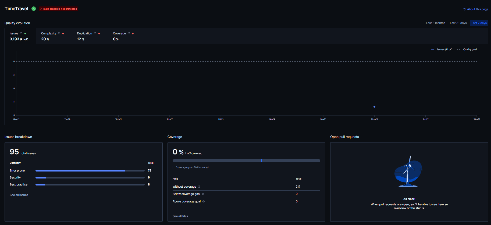
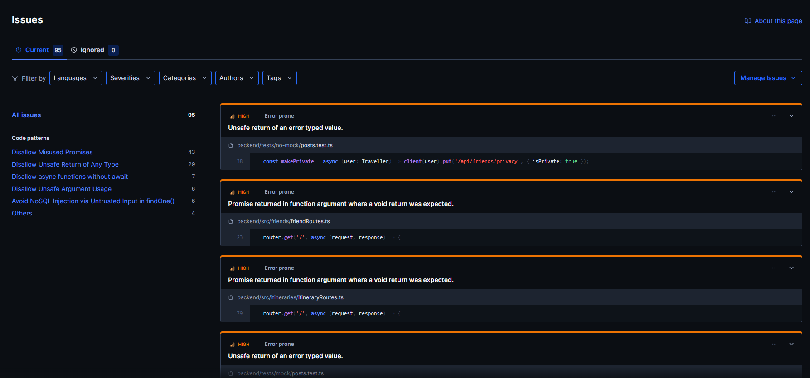

# Code Review

## 1. Change History

| **Change Date** | **Modified Sections** | **Rationale** |
| --------------- | --------------------- | ------------- |
| 2026-10-18 | 2, 3 | CP1: recorded the status of the automated and manual code reviews. Neither has run yet; both are scheduled for later checkpoints (see below). |
| 2026-10-26 | 2 | CP2: checked the code with the course's ESLint and detekt configurations (2 ESLint findings, justified in 2.4; none from detekt); Codacy's own run on the group repository fills in 2.1-2.3. |
| 2026-10-27 | 2 | CP2: recorded Codacy's run on the final CP2 commit. Codacy found 103 issues on `8e9f3f7`; commit `ceec5d9` fixed 8 (vulnerable dependencies, `$null` comparisons in `run-backend.ps1`, a hard-coded secret in a test), and the other 95 are justified in 2.4. |

---

## 2. Automated Code Review Results

**Status at CP2:** Codacy analyses `abhiverma13/TimeTravel` with its default coding standard. On `8e9f3f7` it reported 103 issues. Commit `ceec5d9` fixed 8 of them: 4 vulnerable dependencies (`qs`, `body-parser`, `proxy-addr`, updated in `backend/package-lock.json`), 2 `$null` comparisons in `scripts/run-backend.ps1`, and 2 findings of a hard-coded JWT secret in `backend/tests/no-mock/auth.test.ts`. The remaining 95 are justified in 2.4.

Before that run, the CP2 code was checked locally with the course's linter configurations: ESLint with the course's [`.eslintrc.json`](../.eslintrc.json) over `backend/src` and `backend/tests`, and detekt 1.23.8 with the course's [`detekt.yml`](../detekt.yml) over `frontend/app/src`. ESLint reports 2 findings (both explained in 2.4) and detekt reports none.

### 2.1. Commit Hash Where Codacy Ran

`ceec5d99d70ad8d0d26c8d107e0d631a3d966fd9`

### 2.2. Unfixed Issues per Codacy Category

95 unfixed issues: 78 Error Prone, 9 Security and 8 Best Practice.

### 2.3. Unfixed Issues per Codacy Code Pattern

The 4 issues Codacy groups under "Others" are one each of:

| **Code pattern** | **Tool** | **Category** | **Issues** |
| ---------------- | -------- | ------------ | ---------- |
| Enforce specifying a non-root USER in Dockerfile | Opengrep | Security | 1 |
| Avoid Server-Side Request Forgery (SSRF) by Validating User-Controlled URLs | Opengrep | Security | 1 |
| Detect Non-Literal Filename in fs Calls | ESLint | Security | 1 |
| Disallow Redundant Type Constituents in Unions and Intersections | ESLint | Best Practice | 1 |

### 2.4. Justifications for Unfixed Issues

- **Error Prone and Best Practice: TypeScript rules that need type information** (ESLint), 86 issues:
    - `@typescript-eslint/no-misused-promises`, 43 issues, the `async` route handlers in [`backend/src/*/*Routes.ts`](../backend/src) (for example [`groupRoutes.ts`](../backend/src/groups/groupRoutes.ts)).
    - `@typescript-eslint/no-unsafe-return`, 29 issues, test helpers in [`backend/tests`](../backend/tests) that return a `supertest` request (for example `post: (path, body) => request(app).post(path)...`).
    - `@typescript-eslint/require-await`, 7 issues, test helpers in [`backend/tests`](../backend/tests) that are `async` and return a `supertest` request or a promise.
    - `@typescript-eslint/no-unsafe-argument`, 6 issues: 4 in [`backend/src/sync/tripSync.ts`](../backend/src/sync/tripSync.ts) (the Socket.io session's user id and acknowledgement callbacks), 1 in [`backend/tests/helpers/testDatabase.ts#L14`](../backend/tests/helpers/testDatabase.ts#L14) and 1 in [`backend/tests/nfr/liveUpdateLatency.test.ts#L65`](../backend/tests/nfr/liveUpdateLatency.test.ts#L65).
    - `@typescript-eslint/no-redundant-type-constituents`, 1 issue, `let memoryServer: MongoMemoryServer | undefined` in [`backend/tests/helpers/testDatabase.ts#L9`](../backend/tests/helpers/testDatabase.ts#L9).
    - **Justification:** these rules read the types of the values involved, and Codacy analyses the repository without installing its npm dependencies. The types from `express`, `supertest`, `socket.io` and `mongodb-memory-server` are therefore unknown to it, and it treats them as `any`: its own messages say so ("Unsafe return of an error typed value", "'any' overrides all other types in this union type" for `MongoMemoryServer | undefined`). With the dependencies installed, none of the 86 is reported: the course's [`.eslintrc.json`](../.eslintrc.json) turns all five rules on as errors, and running them over `backend/src` and `backend/tests` with `backend/tsconfig.json` on commit `ceec5d9` reports no findings. With the real types, Express 5's handler type allows a returned promise (Express 5 passes a rejected one to the error handler), and a `supertest` request is a promise-like value, so returning it from an `async` helper is neither unsafe nor a missing `await`.

- **Security: `rule-node-nosqli-injection`** (Opengrep), 6 issues:
    - [`backend/src/activities/activityService.ts#L176`](../backend/src/activities/activityService.ts#L176) and [`#L180`](../backend/src/activities/activityService.ts#L180), [`backend/src/posts/postService.ts#L199`](../backend/src/posts/postService.ts#L199) and [`#L200`](../backend/src/posts/postService.ts#L200), [`backend/src/friends/friendService.ts#L118`](../backend/src/friends/friendService.ts#L118) and [`#L195`](../backend/src/friends/friendService.ts#L195).
    - **Justification:** a NoSQL injection needs a request to put an object, such as `{ "$ne": null }`, into a query field. None of these queries can receive one. Ids from the request are path parameters, which Express always parses as strings; each is checked with `isValidObjectId` and turned into an `ObjectId` before it is queried (`activityId` at [`activityService.ts#L142-L145`](../backend/src/activities/activityService.ts#L142-L145), `postId` and `commentId` at [`postService.ts#L200`](../backend/src/posts/postService.ts#L200) and [`#L220`](../backend/src/posts/postService.ts#L220), the friend's id in `requireUser` at [`friendService.ts#L187`](../backend/src/friends/friendService.ts#L187)). The other values are built by the server: a city key read back from the stored activity, and the friendship key `pairKey(a, b)`, a string made of two user ids.

- **Security: `rule-node-ssrf`** (Opengrep), 1 issue at [`backend/tests/helpers/liveServer.ts#L31`](../backend/tests/helpers/liveServer.ts#L31)
    - **Justification:** this is test code. The Socket.io client connects to the address `startLiveServer` returns for the test server it has just started on a free local port (`http://localhost:<port>`, [`liveServer.ts#L16-L27`](../backend/tests/helpers/liveServer.ts#L16-L27)). No user input reaches the URL, and the file is not part of the deployed server.

- **Security: `missing-user`** (Opengrep), 1 issue at [`backend/Dockerfile#L21`](../backend/Dockerfile#L21)
    - **Justification:** the back-end container runs as root. It reads the TLS key that the deployment mounts read-only from the VM ([`docker-compose.yml`](../docker-compose.yml), `./backend/certs:/certs:ro`), and that key is created by, and readable only by, the VM's own user; switching the container to the unprivileged `node` user needs the key's ownership on the VM changed together with the image, and a redeploy, which we did not risk before the CP2 deadline. The exposure is limited: the container runs only the TimeTravel back-end, it publishes only the back-end's port, MongoDB is not published outside the Docker network, and the certificates are mounted read-only. Running as `node` is planned for the next deployment.

- **Security: `security/detect-non-literal-fs-filename`** (ESLint), 1 issue at [`backend/src/index.ts#L50`](../backend/src/index.ts#L50) (the course's ESLint configuration reports its two calls as 2 findings)
    - **Justification:** the server reads its TLS certificate and key with `readFileSync(env.tlsCertPath)` and `readFileSync(env.tlsKeyPath)`. The rule flags any file path that is not a literal, because a path built from user input could read any file. These paths come only from the server's own `.env` (`TLS_CERT_PATH`, `TLS_KEY_PATH`), set by whoever deploys it; no request can reach them, and they are read once at start-up. A literal path would tie the code to one server's layout (the deployment mounts the certificates at `/certs/...`), so the rule does not apply here.

---

## 3. Manual Code Review Results

**Status at CP1:** the peer review has not started. Artifacts are exchanged with the peer group by **November 2** (CP1 Progress, task 7), and the review report and this section are due **November 16** (task 10).

### 3.1. Review You Performed

- **Peer group reviewed:** _to be assigned_
- **Commit SHA reviewed:** _not yet exchanged_
- **Date the artifacts were exchanged:** _planned for November 2_
- **Review report submitted:** _not yet written_

The scores (manual code review, manual test review, automated code review) and the major fault will be recorded here after the review.

### 3.2. Review You Received

- **Reviewing group:** _to be assigned_
- **Commit SHA that was reviewed:** _not yet exchanged_
- **Review report received:** _not yet received_

The scores and the major fault reported against TimeTravel will be recorded here when the report is received.

### 3.3. Actions Taken in Response to the Review

_None yet. Each finding from the review received, the action taken and the commit or location in Git will be listed here, together with a justification for any finding not acted on._
