# Requirements and Design

## 1. Change History

| **Change Date** | **Modified Sections** | **Rationale** |
| --------------- | --------------------- | ------------- |
| 2026-10-17 | All | First version for CP1, written from the M2 presentation. |
| 2026-10-17 | 3.4, 3.5, 4.1 | Create Trip and Generate Itinerary share one Trip Builder screen, so a trip is saved with the itinerary it produces. |
| 2026-10-17 | 3.7, 4.7 | Added NFR 3 to give the M2 decision to cache metered Google calls a testable target. |
| 2026-10-26 | 3.1, 3.3, 3.4, 4.1, 4.2 | Built collaborative trips on travel groups, owned by a new Group Service, so the same friends can plan several trips without inviting each other again. Join Trip & Set Preferences became Create Group, Join Group, Set Group Preferences and Leave Group. |
| 2026-10-26 | 3.1, 3.5, 4.1, 4.4, 4.7 | Implemented View & Adjust Itinerary with live updates over Socket.io, chosen over plain `ws` because it is on the course's approved list and reconnects by itself. A version number stops simultaneous edits from overwriting each other. |
| 2026-10-26 | 3.1, 3.4, 3.5, 4.1, 4.2, 4.3, 4.7 | Added trip options (way of getting around, budget, must-see and avoided places), Google Routes travel times cached for a week, and Add Place to Itinerary, which makes room on a full day because the planner fills every day. |
| 2026-10-26 | 3.1, 3.4, 3.5, 4.1, 4.2 | Added F6 friends and private accounts, owned by a new Friend Service because it alone decides who sees what, and a bottom navigation bar. |
| 2026-10-26 | 3.1, 3.4, 4.1, 4.2 | Completed F6 with the trip feed, owned by a new Feed Service. A post keeps a frozen copy of the plan, and a copy re-times each day instead of re-planning, to keep the same places. |
| 2026-10-26 | 3.1, 3.4, 4.1, 4.3, 4.4 | Added F7 Trip map and live location. Positions are relayed live, never stored and never tracked in the background, because location is the app's most sensitive data. |
| 2026-10-26 | 3.1, 3.4, 4.1, 4.2 | Added F8 Nearby trips, owned by a new Nearby Service. Nearby travellers see only the plan, never the lodging or anyone's position. |
| 2026-10-26 | 3.1, 3.4, 3.5, 4.1, 4.2 | Added verified reviews to F2, which need both the reviewer's position and their trip so passers-by are not verified, and a list of an activity's reviews. |
| 2026-10-26 | 3.1, 3.4, 3.5, 4.1, 4.2, 4.3, 4.7 | Implemented F5 as suggestions that members accept or dismiss, so a wrong forecast cannot rearrange a day. Dropped Firebase Cloud Messaging, since suggestions appear when the trip is open. |
| 2026-10-26 | 3.2, 3.4, 4.5, 4.6 | Redrew the use case and dependency diagrams for CP2, and updated the sequence diagrams to match the implementation. |
| 2026-11-02 | All | Shortened the wording after CP1 feedback, and removed the legends from the use case and dependency diagrams. |
| 2026-11-12 | All | Called every planned trip a "trip": the word "itinerary" is gone from the use cases, interfaces (`/api/trips`), components (Trip Service, Trip Engine) and database (`trips`), because two words for one thing confused readers. |
| 2026-11-12 | 4.1 | Fixed the peer review's major fault: a member removed from a group kept receiving its live locations. The Group Service now announces who lost access, and the hub disconnects them from the group's trips at once (`tripAccessLost`); every shared position also re-checks access. |

---

## 2. Project Description

Planning a trip is a scheduling problem, but every tool treats it as a search problem. Travellers collect places from Google Maps, Reddit and blogs, check opening hours one venue at a time, and lay out the days in a notes app. The result is predictable: the museum is closed on Monday, two must-dos 50 minutes apart share an afternoon, and one day has nine empty hours.

**TimeTravel** closes the loop. Travellers who have been to a place rate and tag its activities (visit length, best time of day, indoor or outdoor, cost), building a community score. A visitor describes their trip (dates, arrival and departure times, lodging, interests and pace), and our trip engine ranks the city's activities and schedules them under opening hours and travel time into a day-by-day plan. The plan is shared with the travel party and adapts when rain or a closed venue disrupts it. The audience is short-stay leisure travellers and small groups travelling together.

---

## 3. Requirements Specification

### **3.1. List of Features**

1. **F1 Sign in with Google** (CP1): the back-end verifies the Google ID token and issues its own session token. The profile's home city and interests prefill searches and trips.
2. **F2 Explore & review activities** (CP1, extended in CP2): browse a city's activities, rate and tag them, and read others' reviews. A review written at the place during the reviewer's trip is verified and counts double.
3. **F3 Trip generation** (CP1, extended in CP2): our own algorithm turns trip details into a ranked, time-feasible, day-by-day plan. It uses the traveller's way of getting around, budget, and places to see or avoid, with travel times from Google Routes. A place found in Explore can be added to a trip.
4. **F4 Collaborative trips, live** (CP2): friends join a group with an invite code, and every member's interests and vetoes shape its plans. Any member can adjust a stop or re-plan a day, and every member's open app updates within seconds.
5. **F5 Disruption-aware re-planning** (CP2): a back-end timer checks the forecast and venue status for trips under way, and suggests a change for rain during an outdoor stop or a closed venue. Nothing changes until a member accepts.
6. **F6 Friends and the trip feed** (CP2): travellers become friends by request and share trips with a rating and caption to the Friends and Everyone feeds; a private account's posts reach friends only. Posts can be liked, commented on and copied onto new dates.
7. **F7 Trip map and live location** (CP2): a map of each day's stops and route with the traveller's position. On the trip's day, arriving within 100 m ticks a stop off. Group members can share their positions while the map is open; positions are never stored.
8. **F8 Nearby trips** (CP2): a group's owner opens a group trip to nearby travellers, who see its plan (never the lodging or anyone's position) and can ask to join.

How the features satisfy the project scope:

| **Project-scope requirement** | **Feature** | **How we satisfy it** |
| --- | --- | --- |
| Authentication via an external authentication service | F1 | Google Identity Services; the back-end verifies the ID token and issues its own session token. |
| At least one feature uses an external service through an API | F2, F3 | Google Places for the activity catalogue, opening hours and lodging; Google Routes for travel times (4.3). |
| At least one feature changes app content or state in response to an external event | F4, F5 | A member's edit changes the plan, and a forecast change or venue closure produces a suggestion; both are pushed over Socket.io to every open device. |
| At least one feature involves logic or computation we implement ourselves | F3, F5 | The Trip Engine: candidate pruning, scoring, and constrained day scheduling with local search (an Orienteering Problem with Time Windows). |

### **3.2. Use Case Diagram**

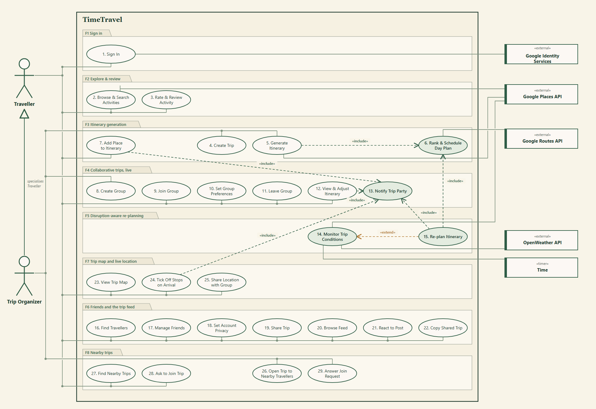

Each feature is a package, and each branch of an actor's line ends at one of its use cases. The Trip Organizer specialises the Traveller and inherits its associations. Shaded use cases are started by the system or reached only through «include». Source: [`res/use_case_diagram.svg`](res/use_case_diagram.svg).

### **3.3. Actors Description**

1. **Traveller**: any app user. Browses and reviews activities, joins groups, sets interests, and follows or adjusts trips.
2. **Trip Organizer**: a Traveller who creates a group, describes a trip and has it planned. A group's owner can also remove members and delete the group.
3. **Google Identity Services**: authenticates the user and returns a signed ID token.
4. **Google Places API**: supplies the activity catalogue and opening hours, finds the lodging, and reports closed venues.
5. **Google Routes API**: supplies travel times between stops.
6. **OpenWeather API**: supplies the forecast used to detect rain during outdoor stops.
7. **Time**: triggers the periodic check of active trips.

### **3.4. Use Case Description**

- Use cases for feature 1: **Sign in with Google**
  1. **Sign In**: the traveller signs in with Google, stays signed in across restarts, and sets their home city and interests.
- Use cases for feature 2: **Explore & review activities**
  2. **Browse & Search Activities**: the traveller lists a city's activities by community score, optionally for one interest, and reads their reviews.
  3. **Rate & Review Activity**: the traveller rates an activity 1 to 5 stars, optionally with a review and tags; a review written at the place during their trip is verified.
- Use cases for feature 3: **Trip generation**
  4. **Create Trip**: the organizer enters the destination, dates, hours, lodging, interests, pace, way of getting around, budget, and places to see or avoid.
  5. **Plan Trip**: the organizer receives a day-by-day plan for the trip.
  6. **Rank & Schedule Day Plan**: the Trip Engine ranks candidates and schedules one day under opening hours, travel time and pace. Included by Plan Trip and Re-plan Trip.
  7. **Add Place to Trip**: a traveller adds an activity from Explore to a trip day; on a full day, the lowest-ranked unlocked stops make room.
- Use cases for feature 4: **Collaborative trips, live**
  8. **Create Group**: the organizer names a group and gets an invite code.
  9. **Join Group**: a traveller joins a group with its invite code.
  10. **Set Group Preferences**: a member sets their interests and vetoes activities for the group's trips.
  11. **Leave Group**: a member leaves, or the owner removes a member or deletes the group.
  12. **View & Adjust Trip**: a traveller locks, moves, removes or marks a stop visited, and the affected part of the day is re-planned.
  13. **Notify Trip Party**: every member's device receives the updated plan when it changes. Included by Add Place to Trip, View & Adjust Trip, Tick Off Stops on Arrival and Re-plan Trip.
- Use cases for feature 5: **Disruption-aware re-planning**
  14. **Monitor Trip Conditions**: on a timer, the system checks the forecast and venue status of active trips' upcoming stops.
  15. **Re-plan Trip**: for a disrupted stop, the system suggests a new day that members accept or dismiss.
- Use cases for feature 6: **Friends and the trip feed**
  16. **Find Travellers**: a traveller searches for others by name or email and opens a profile.
  17. **Manage Friends**: a traveller sends, answers or cancels friend requests, or removes a friend.
  18. **Set Account Privacy**: a traveller makes their account private (details and posts for friends only) or public.
  19. **Share Trip**: a traveller posts a trip with a star rating and an optional caption.
  20. **Browse Feed**: a traveller reads the Friends or Everyone feed, optionally for one city, or one traveller's posts.
  21. **React to Post**: a traveller likes posts and adds or deletes comments; a post's author can delete the post or any comment on it.
  22. **Copy Shared Trip**: a traveller copies a shared trip into their own trips on new dates.
- Use cases for feature 7: **Trip map and live location**
  23. **View Trip Map**: a traveller sees a day's stops, the route, their position and the distance to the next stop.
  24. **Tick Off Stops on Arrival**: on the trip's day, arriving within 100 m of a stop marks it visited for everyone in the trip.
  25. **Share Location with Group**: a group member shares their position with the members who have the map open.
- Use cases for feature 8: **Nearby trips**
  26. **Open Trip to Nearby Travellers**: a group's owner opens or closes a group trip to nearby travellers.
  27. **Find Nearby Trips**: a traveller sees open trips near them in the Nearby tab.
  28. **Ask to Join Trip**: a traveller asks to join an open trip's group, with an optional note.
  29. **Answer Join Request**: the owner accepts a request, adding the traveller to the group, or declines it.

### **3.5. Formal Use Case Specifications (5 Most Major Use Cases)**

#### Use Case 1: Browse & Search Activities

**Description**: The traveller lists a city's activities by community score, optionally for one interest.

**Primary actor(s)**: Traveller (secondary: Google Places API)

**Main success scenario**:
1. The traveller taps Explore in the bottom navigation bar.
2. The app shows a city field prefilled with the traveller's home city, a Search button and interest filters (All, Museums, Outdoors, Food, Shopping, Landmarks, Nightlife, Family).
3. The traveller enters a city, optionally selects an interest filter, and taps Search.
4. The system loads the city's activities from its cache, or from Google Places if the city was not fetched in the last 7 days.
5. The app lists the activities, best community score first, each with its name, interests, score, review counts, visit length, today's opening hours and top tags.

**Failure scenario(s)**:
- 3a. The city field is empty.
    - 3a1. The app shows "Enter a city to explore." and does not search.
- 4a. Google Places cannot be reached and the city has never been fetched.
    - 4a1. The app shows "Could not load activities from Google Places".
    - 4a2. The traveller can tap Search again later.
- 4b. Google Places cannot be reached, but an older copy of the city is cached.
    - 4b1. The system uses the older copy and the scenario continues at step 5.
- 4c. The app cannot reach TimeTravel.
    - 4c1. The app shows "Couldn't reach TimeTravel. Check your connection and try again."
- 5a. The city has no activities.
    - 5a1. The app shows "No activities found for &lt;city&gt;."

#### Use Case 2: Rate & Review Activity

**Description**: A traveller rates an activity from 1 to 5 stars, optionally with a review and tags, updating its community score and tags.

**Primary actor(s)**: Traveller

**Main success scenario**:
1. On an activity's card in Explore & review, the traveller taps Rate.
2. The app opens a rating dialog with five stars, a review field and optional tags. Submit is disabled.
3. The traveller selects a star rating. Submit becomes enabled.
4. The traveller optionally writes a review and selects tags, then taps Submit.
5. The system saves the review, replacing any earlier one by the traveller, and recomputes the activity's score and tags. A review sent with a position within 150 m of the place, on a day the place is in one of the traveller's trips, is verified and counts double.
6. The app closes the dialog, updates the card and shows "Thanks! Your review of &lt;activity&gt; was saved.", adding "It has a Verified visit badge and counts double." for a verified review.

**Failure scenario(s)**:
- 4a. The traveller types more than 500 characters.
    - 4a1. The review field stops accepting characters at 500.
- 4b. The traveller taps Cancel.
    - 4b1. The dialog closes and nothing is saved.
- 5a. The activity no longer exists.
    - 5a1. The dialog shows "Activity not found" and stays open.
- 5b. TimeTravel cannot be reached or reports an error.
    - 5b1. The dialog shows the error and stays open, so the traveller can submit again.

#### Use Case 3: Plan Trip

**Description**: The organizer describes a trip and receives a ranked, time-feasible, day-by-day plan.

**Primary actor(s)**: Trip Organizer (secondary: Google Places API, Google Routes API)

**Main success scenario**:
1. The organizer taps "Plan a trip" on the home screen.
2. The app shows the Trip Builder, with the destination and interests prefilled from the organizer's profile.
3. The organizer enters the destination city and chooses the trip's first and last day.
4. The organizer optionally changes the daily start and end times, sets arrival and departure times, enters their lodging, and changes the interests and pace.
5. The organizer optionally chooses how they get around (Walk, Transit or Drive) and a budget per activity (Any, $ or $$), and taps "Choose places" to mark places as must-see (one tap) or avoid (two taps).
6. The organizer taps "Generate trip".
7. The system leaves out avoided and over-budget places, ranks the rest with must-see places first, gets travel times from Google Routes, and schedules each day around opening hours, travel time, the day's hours and the pace, starting and ending at the lodging.
8. The app shows a day-by-day timeline with each stop's time, name, score and interests, the travel time between stops (for example "12 min walk"), and when the organizer is back at the lodging. The summary says whether travel times come from Google Routes or are estimated.

**Failure scenario(s)**:
- 3a. The destination is empty.
    - 3a1. The app shows "Enter a destination city." and does not generate.
- 3b. No dates are chosen.
    - 3b1. The app shows "Choose your trip dates." and does not generate.
- 3c. The trip is longer than 7 days.
    - 3c1. The app shows "Trips can be at most 7 days." and does not generate.
- 4a. The day ends less than 2 hours after it starts.
    - 4a1. The app shows "Your day must end at least 2 hours after it starts." and does not generate.
- 5a. The destination is empty when the organizer taps "Choose places".
    - 5a1. The app shows "Enter a destination city." and does not open the list.
- 7a. The city has no activities.
    - 7a1. The app shows "No activities found for &lt;city&gt;" under the form.
- 7b. The lodging cannot be found.
    - 7b1. The system plans the days from the centre of the city's activities.
    - 7b2. The trip shows a warning: "Could not find "&lt;lodging&gt;"; days start and end at the &lt;city&gt; centre."
- 7c. No activity fits a day (for example, the hours are outside every opening time).
    - 7c1. That day shows "Nothing fits this day. Try longer days or other interests." If no day has a stop, the trip also warns "No activity fits these dates and hours; try longer days or different interests."
- 7d. A must-see place fits no day (for example, it is closed on every day of the trip).
    - 7d1. The trip shows a warning: "&lt;place&gt; did not fit your days: check its opening hours."
- 7e. Google Routes cannot be reached.
    - 7e1. The system uses its offline travel-time estimate, and the summary says "estimated travel times".
- 7f. The app cannot reach TimeTravel.
    - 7f1. The app shows "Couldn't reach TimeTravel. Check your connection and try again." and the organizer can tap "Generate trip" again.

#### Use Case 4: View & Adjust Trip

**Description**: A traveller locks, removes or moves a stop; the affected part of the day is re-planned and the change appears on every member's device.

**Primary actor(s)**: Traveller

**Main success scenario**:
1. The traveller opens a trip from the home screen's recent trips or from its group's page.
2. The app shows the trip timeline, connects to live updates and shows "Live".
3. The traveller opens a stop's menu and locks, unlocks, moves (earlier or later) or removes it, or taps "Re-plan" on a day.
4. The system re-plans the affected part of the day. Locked stops keep their times, a removed stop's time goes to another activity, and re-planning today keeps the stops already started.
5. Every group member's app, including the traveller's, shows the updated timeline within 2 seconds; the others also see who changed what (for example "Ava removed English Bay Beach").

**Failure scenario(s)**:
- 2a. The trip does not exist or the traveller is not in the trip's group.
    - 2a1. The app shows "Trip not found" with a Try again button.
- 2b. The live connection is lost.
    - 2b1. The app shows "Offline: live updates will resume when you reconnect."
    - 2b2. When the connection returns, the app shows "Live" again and reloads the latest trip.
- 4a. No feasible plan keeps the requested change (for example, a moved stop would miss its opening hours).
    - 4a1. The app explains why and keeps the previous plan.
- 4b. Another member changed the trip after the traveller loaded it.
    - 4b1. The change is refused, the app shows "Someone changed this plan first. Here is the latest version." and reloads it.

#### Use Case 5: Re-plan Trip

**Description**: When rain threatens an outdoor stop or a venue closes, the system suggests a new day to the trip's members; the plan changes only if one of them accepts.

**Primary actor(s)**: Time (secondary: OpenWeather API, Google Places API)

**Main success scenario**:
1. Every 30 minutes, the system checks the stops starting in the next 36 hours of each trip under way: the forecast for outdoor stops (a 60% chance of rain or more) and Google's business status for every stop.
2. The system detects a disruption: rain during an outdoor stop, or a closed venue.
3. The system plans the day without that stop, filling the time with another activity (only indoor ones in the rain) and keeping locked stops.
4. Every member with the trip open sees a suggestion card above the trip with the proposed day, for example "Rain is likely at 10:52 during VanDusen Botanical Garden. Swap it for Canada Place?".
5. A member taps Accept.
6. The system saves the new day, and every member's app shows it with "Ava accepted a suggestion: swapped VanDusen Botanical Garden for Canada Place".

**Failure scenario(s)**:
- 1a. The forecast or Google Places cannot be reached.
    - 1a1. The system skips that check, keeps the plan, and checks again at the next interval.
- 3a. No other activity fits the freed time.
    - 3a1. The suggestion offers to take the stop out and keep the time free.
- 4a. A member's device is offline or the trip is not open.
    - 4a1. The suggestion appears the next time they open the trip.
- 5a. A member taps Dismiss.
    - 5a1. The suggestion disappears and the plan stays as it is.
- 5b. Someone changed the trip after the suggestion was made, or 12 hours passed.
    - 5b1. The suggestion is no longer shown; accepting it anyway shows "The trip changed since this suggestion; it no longer applies".

### **3.6. Screen Mock-ups**

Screens from the CP1 build:

| Sign in | Trip Builder | Trip | Explore & review |
| --- | --- | --- | --- |
| 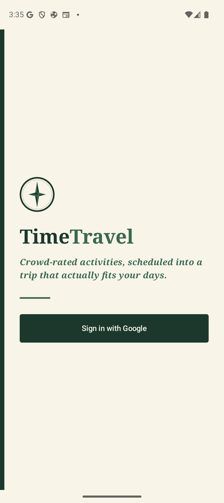 | 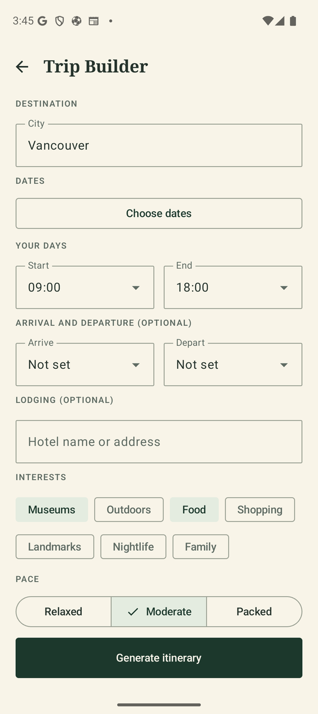 | 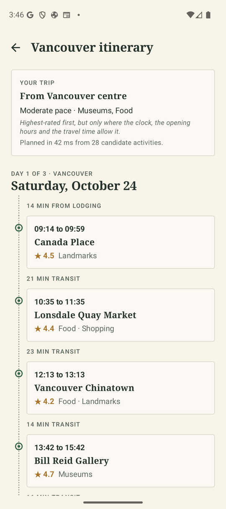 | 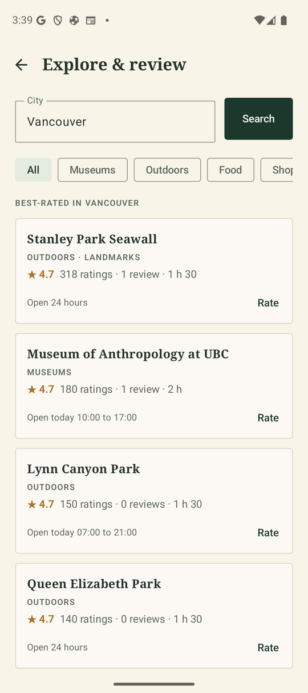 |

### **3.7. Non-Functional Requirements**

1. **Trip generation time**
    - **Description**: Generating a 5-day trip from up to 40 candidate activities takes under 3 seconds at the 95th percentile, measured at the back-end from request received to response sent.
    - **Justification**: The organizer waits on "Generate trip", and every re-plan runs the same solve. Nielsen puts the limit for keeping a user's attention at 10 s ([Nielsen, *Response Times: The 3 Important Limits*](https://www.nngroup.com/articles/response-times-3-important-limits/)); 3 s stays well inside it while leaving room for travel-time lookups. Five days is a typical short stay, and 40 is the engine's candidate cap.

2. **Live update latency**
    - **Description**: When a trip changes (a member's adjustment or a disruption re-plan), every member's connected device shows the new plan within 2 seconds.
    - **Justification**: A shared trip only works if members standing together see the same plan; after 2 seconds people start acting on the old one.

3. **Bounded Google Places usage**
    - **Description**: Each city's catalogue is fetched from Google Places at most once every 7 days (one text search per interest tag, 7 in total); searching or generating for a city fetched in the last 7 days makes no Places calls.
    - **Justification**: Places is billed per call and the project runs on limited cloud credits. Catalogues change slowly, so a week-old one is still accurate, while fetching per search would multiply cost by users and searches.

---

## 4. Designs Specification

### **4.1. Main Components**

1. **Auth & Profile Service**
    - **Purpose**: Verifies Google ID tokens, issues session tokens and stores profiles. It is separate because every component depends on its session check, and it keeps all Google Identity code in one place.
    - **Interfaces**:
        1. `POST /api/auth/google` body `{ idToken: string }` returns `{ token: string, user: UserProfile }`
            - **Purpose**: Verifies the ID token with Google, creates or updates the user, and returns a 7-day session token.
        2. `GET /api/users/me` returns `UserProfile { id, email, name, homeCity, interests }`
            - **Purpose**: Returns the signed-in traveller's profile; the app also uses it to validate a stored session.
        3. `PUT /api/users/me` body `{ homeCity?: string, interests?: string[] }` returns `UserProfile`
            - **Purpose**: Sets the traveller's home city and interests.
        4. `String verifySessionToken(String token)`
            - **Purpose**: Called by every component on each request; returns the token's user id or rejects the request with 401.
2. **Activity & Review Service**
    - **Purpose**: Caches city catalogues from Google Places, stores reviews, and computes community scores and tags. Caching whole catalogues, rather than searching per request, bounds Places cost and latency (NFR 3).
    - **Interfaces**:
        1. `GET /api/activities?city=<city>&interest=<tag>` returns `{ city: string, activities: ActivityDto[] }`
            - **Purpose**: Returns a city's activities, best community score first, optionally for one interest. `ActivityDto` is `{ id, name, address, location, interests, durationMinutes, communityTags, googleRating, googleRatingCount, reviewCount, communityScore, openingHours, cost, verifiedReviewCount }`.
        2. `POST /api/activities/{activityId}/reviews` body `{ rating: 1-5, comment?: string, tags?: { durationMinutes?, bestTimeOfDay?, cost?, setting? }, location?: { lat, lng } }` returns `{ review: ReviewDto, activity: ActivityDto }`
            - **Purpose**: Creates or edits the traveller's review and returns the activity with its new score. A `location` within 150 m of the place, on a day the place is in one of the traveller's trips, marks the review verified, and it counts double.
        3. `GET /api/activities/{activityId}/reviews` returns `{ reviews: ReviewListItemDto[] }`
            - **Purpose**: Returns up to 50 reviews, verified first, then newest.
        4. `ActivityDto[] listActivities(String city, String interest)`
            - **Purpose**: Called by the Trip Engine for candidates; refreshes the catalogue from Places when it is older than 7 days.
3. **Trip Engine**
    - **Purpose**: Our own planning logic: candidate pruning, scoring and constrained day scheduling. It is separate, with a scheduling core that has no I/O, so the part we tune and test hardest is independent of transport and storage.
    - **Interfaces**:
        1. `POST /api/trips/generate` body `{ city, startDate, endDate, dayStart?, dayEnd?, arrivalTime?, departureTime?, interests?, pace?, lodging?, groupId?, transportMode?, budget?, mustSeeIds?, avoidIds? }` returns `TripDto`
            - **Purpose**: Creates a trip of up to 7 days and plans its days. Dates are `YYYY-MM-DD`, times `HH:MM`, and `transportMode` is walk, transit or drive. `budget` leaves out pricier activities, `mustSeeIds` are scheduled first (with a warning for any that fit no day), and `avoidIds` are left out. With `groupId`, the group's combined interests and vetoes replace the caller's. `TripDto` holds the trip details, the resolved lodging, the days with timed stops and travel minutes, and any warnings.
        2. `GET /api/trips?groupId=<id>` returns `{ trips: TripSummary[] }`
            - **Purpose**: Returns the traveller's 20 most recent trips, or one group's with `groupId`.
        3. `GET /api/trips/{tripId}` returns `TripDto`
            - **Purpose**: Returns a trip the traveller owns or shares through a group (404 otherwise).
        4. `TripPlan planTrip(Candidate[] candidates, PlanRequest request, PlanOptions options)`
            - **Purpose**: The scheduling core: prunes candidates, builds each day by greedy insertion, and improves it with time-budgeted local search.
        5. `POST /api/trips/{tripId}/adjust` body `{ action, version, dayIndex, activityId?, toIndex?, fromTime? }` returns `TripDto`
            - **Purpose**: Serves View & Adjust Trip and Add Place to Trip. `action` is `lock`, `unlock`, `visit`, `unvisit`, `remove`, `add`, `move` (with `toIndex`) or `replan` (from an optional `fromTime`). Locked and started stops keep their times, freed time goes to other activities, and `add` on a full day drops the lowest-ranked unlocked stops. A change that leaves no feasible day is refused (422). `version` must be current (409 otherwise), so simultaneous edits never overwrite each other.
        6. `RoutedDay repairDay(Candidate[] kept, Candidate[] pool, DayContext context, DayRepairOptions options)`
            - **Purpose**: The scheduling core for adjustments: keeps the given stops, fills the free time from the pool, and returns null when the kept stops no longer fit.
        7. `TravelTimes forPoints(GeoPoint[] points, TransportMode mode, boolean fetchMissing)`
            - **Purpose**: Returns travel times between points: cached Google Routes times, missing pairs fetched from Routes when `fetchMissing` is set, and the offline estimate otherwise. Only generation fetches, so adjustments never wait on Google.
        8. `TripSnapshot snapshot(String userId, String tripId)` and `TripDto copyTrip(String userId, TripSnapshot trip, String startDate, String note)`
            - **Purpose**: Called by the Feed Service to freeze a trip for a post, and to copy a shared trip onto new dates with each day re-timed.
        9. `boolean isScheduledOn(String userId, ObjectId activityId, String date)`
            - **Purpose**: Called by the Activity & Review Service to verify a visit: whether the activity is a stop on that date in one of the traveller's trips.
        10. `ProposedDay proposeReplacement(ObjectId tripId, int dayIndex, String activityId, Filter allowed)` and `TripDto applyProposedDay(String userId, String tripId, ProposedDay proposal, int dayIndex, String summary)`
            - **Purpose**: Called by the Trip Sync & Disruption Service to build a day with one stop replaced, and to save it once a member accepts, if the trip is unchanged.
4. **Group Service**
    - **Purpose**: Manages groups, members, invite codes, and each member's interests and vetoes. It is separate because the Trip Engine and the Trip Sync & Disruption Service need the same membership answer. Group trips belong to the current members, so leaving a group removes access to its trips.
    - **Interfaces**:
        1. `POST /api/groups` body `{ name: string }` returns `GroupDto`
            - **Purpose**: Creates a group owned by the caller with a unique 6-character invite code. `GroupDto` is `{ id, name, inviteCode, myRole, members: [{ userId, name, role, interests, vetoedActivityIds }], createdAt }`.
        2. `GET /api/groups` returns `{ groups: GroupSummary[] }`
            - **Purpose**: Returns the caller's groups with their member counts and the caller's role.
        3. `POST /api/groups/join` body `{ inviteCode: string }` returns `GroupDto`
            - **Purpose**: Adds the caller to the group with that code, up to 12 members (409 when full).
        4. `GET /api/groups/{groupId}` returns `GroupDto`
            - **Purpose**: Returns a group the caller belongs to (404 otherwise, so groups are not revealed).
        5. `PUT /api/groups/{groupId}/members/me` body `{ interests?: string[], vetoedActivityIds?: string[] }` returns `GroupDto`
            - **Purpose**: Sets the caller's interests and vetoes for the group's trips.
        6. `DELETE /api/groups/{groupId}/members/{userId}` returns 204
            - **Purpose**: A member leaves, or the owner removes a member. The owner cannot leave (409) and deletes the group instead.
        7. `DELETE /api/groups/{groupId}` returns 204
            - **Purpose**: The owner deletes the group and its trips (403 for other members).
        8. `GroupTripPreferences tripPreferences(String userId, String groupId)`
            - **Purpose**: Called by the Trip Engine: each interest weighted by the share of members who picked it, and all members' vetoes.
        9. `Group addMember(ObjectId groupId, String userId)`
            - **Purpose**: Adds a traveller with their profile interests in one atomic update (409 if full); used when joining by code and by the Nearby Service.
        10. `GroupTripPreferences preferencesOf(ObjectId groupId)`
            - **Purpose**: Returns the combined preferences without an access check, for callers already checked and for the timer.
        11. `void onMembersLeft(MembersLeft left)`, with `MembersLeft` `{ groupId, userIds, tripIds }`
            - **Purpose**: Tells the Trip Sync & Disruption Service who lost access to which trips after a member leaves or is removed, or the group is deleted.
5. **Trip Sync & Disruption Service**
    - **Purpose**: A Socket.io hub with one room per trip, plus a timer that detects disruptions and asks the Trip Engine for proposed changes. A persistent socket, rather than polling, delivers a change to every device within seconds (NFR 2).
    - **Interfaces**:
        1. Socket.io handshake `auth: { token }`; client event `subscribe { tripId }` (acknowledged with `{ ok: true }` or `{ ok: false, error }`) and `unsubscribe { tripId }`; server event `tripUpdated { trip: TripDto, actorId, summary }`
            - **Purpose**: A device subscribes to the trips its user may see and receives every saved change with a summary such as "Ava removed English Bay Beach". Changes themselves go through the REST API, so each is validated and versioned in one place.
        2. Socket.io client events `shareLocation { tripId, lat, lng }` (acknowledged) and `stopSharingLocation { tripId }`; server events `memberLocation { tripId, userId, name, lat, lng, at }` and `memberLocationStopped { tripId, userId }`
            - **Purpose**: Relays a subscribed device's position to the trip's other subscribers, after checking again that its traveller can still see the trip. The server stores nothing.
        3. Server event `tripAccessLost { tripId }`
            - **Purpose**: Sent to every device of a traveller who left the trip's group, was removed, or whose group was deleted. Those devices leave the trip's room and stop sharing their position at once, so a removed member sees nothing more.
        4. `void onTripChanged(TripChange change)`
            - **Purpose**: Called by the Trip Engine after each saved change; broadcasts it to the trip's room.
        5. `int checkActiveTrips()`
            - **Purpose**: Runs every 30 minutes: checks the forecast and venue status of stops starting within 36 hours on trips under way, and makes a suggestion for each disrupted stop. One trip's failure never stops the others.
        6. `boolean suggest(ObjectId tripId, int dayIndex, String activityId, String reason)` and server event `suggestionAdded { suggestion: SuggestionDto }`
            - **Purpose**: Asks the Trip Engine for the day without the disrupted stop, saves it as a suggestion for 12 hours, and pushes it to the room, unless one is already waiting for that stop.
        7. `GET /api/suggestions?tripId=<id>` returns `{ suggestions: SuggestionDto[] }`
            - **Purpose**: Returns the trip's waiting suggestions for its current version. `SuggestionDto` is `{ id, tripId, dayIndex, date, activityId, activityName, reason, message, proposedStops, createdAt, expiresAt }`.
        8. `POST /api/suggestions/{suggestionId}/accept` returns `TripDto`
            - **Purpose**: Saves the proposed day if the trip is unchanged (409 otherwise) and pushes it like any adjustment.
        9. `POST /api/suggestions/{suggestionId}/dismiss` returns 204
            - **Purpose**: Turns the suggestion down. Each suggestion is answered once (409 after that).

6. **Friend Service**
    - **Purpose**: Manages traveller search, friend requests, friendships and account privacy. It is separate so the rule for who sees a traveller's details and posts lives in one place.
    - **Interfaces**:
        1. `GET /api/travellers?search=<text>` returns `{ travellers: TravellerDto[] }`
            - **Purpose**: Returns up to 20 travellers whose name contains the text or whose email matches it exactly. `TravellerDto` is `{ id, name, homeCity, isPrivate, friendship }`; `friendship` is `self`, `none`, `requested`, `incoming` or `friends`, and a private non-friend's `homeCity` is empty.
        2. `GET /api/travellers/{userId}` returns `TravellerDto` with `friendCount`
            - **Purpose**: Returns one traveller's profile as the caller may see it.
        3. `GET /api/friends` returns `{ isPrivate, friends: TravellerDto[], incoming: TravellerDto[], outgoing: TravellerDto[] }`
            - **Purpose**: Returns the caller's friends, received and sent requests, and privacy setting.
        4. `POST /api/friends/requests` body `{ userId }` returns `TravellerDto`
            - **Purpose**: Sends a friend request, or accepts theirs if that traveller already asked the caller.
        5. `POST /api/friends/requests/{userId}/accept` returns `TravellerDto`
            - **Purpose**: Accepts that traveller's request.
        6. `DELETE /api/friends/{userId}` returns 204
            - **Purpose**: Removes the friendship or pending request, so unfriending, cancelling and declining are one call.
        7. `PUT /api/friends/privacy` body `{ isPrivate: boolean }` returns `{ isPrivate }`
            - **Purpose**: Makes the caller's account private or public.
        8. `Audience audience(String viewerId)` and `boolean canSee(String viewerId, String authorId)`
            - **Purpose**: Called by the Feed Service: whose posts the viewer may see (their own and friends' always, others' only if public).

7. **Feed Service**
    - **Purpose**: Manages posts, likes, comments and copying shared trips. It is separate because posts outlive their trips and follow the Friend Service's access rule, which keeps the Trip Engine focused on planning.
    - **Interfaces**:
        1. `POST /api/posts` body `{ tripId, rating: 1-5, caption? }` returns `PostDetailDto`
            - **Purpose**: Shares a frozen copy of a trip with a rating and optional caption. `PostDto` is `{ id, author: { id, name }, city, startDate, endDate, dayCount, stopCount, rating, caption, likeCount, likedByMe, commentCount, mine, createdAt }`; `PostDetailDto` adds the `trip`.
        2. `GET /api/posts?feed=friends|everyone&city=<city>&authorId=<id>&before=<ISO time>` returns `{ posts: PostDto[] }`
            - **Purpose**: Returns 20 posts at a time, newest first: `friends` is the caller's and friends' posts, and `everyone` leaves out private accounts the caller is not friends with. `city` and `authorId` filter, and `before` pages.
        3. `GET /api/posts/{postId}` returns `PostDetailDto`
            - **Purpose**: Returns one post if the caller may see it (404 otherwise, so private posts are not revealed).
        4. `DELETE /api/posts/{postId}` returns 204
            - **Purpose**: The author deletes the post and its comments; the source trip is unaffected.
        5. `PUT /api/posts/{postId}/like` and `DELETE /api/posts/{postId}/like` return `{ likeCount, likedByMe }`
            - **Purpose**: Likes or unlikes the post.
        6. `GET /api/posts/{postId}/comments` returns `{ comments: CommentDto[] }`
            - **Purpose**: Returns the post's comments, oldest first. `CommentDto` is `{ id, author: { id, name }, text, mine, createdAt }`.
        7. `POST /api/posts/{postId}/comments` body `{ text }` returns `CommentDto`
            - **Purpose**: Adds a comment.
        8. `DELETE /api/posts/{postId}/comments/{commentId}` returns 204
            - **Purpose**: The comment's author or the post's author deletes the comment.
        9. `POST /api/posts/{postId}/copy` body `{ startDate }` returns `TripDto`
            - **Purpose**: Copies the trip into the caller's trips from `startDate`, re-timing each day for its weekday with `copyTrip`; a stop that no longer fits is left out with a warning.

8. **Nearby Service**
    - **Purpose**: Manages group trips opened to nearby travellers and requests to join them. It is separate because it applies one privacy rule across trip locations and group membership: nearby travellers see the plan, never where members stay or are.
    - **Interfaces**:
        1. `PUT /api/nearby/trips/{tripId}` body `{ openToJoin: boolean }` returns `{ openToJoin }`
            - **Purpose**: The group's owner opens or closes a group trip to nearby travellers.
        2. `GET /api/nearby/trips?lat=<lat>&lng=<lng>` returns `{ trips: NearbyTripDto[] }`
            - **Purpose**: Returns up to 20 open trips, nearest first, with a stop within 10 km that start within 7 days, leaving out the caller's groups. `NearbyTripDto` is `{ tripId, groupId, groupName, organizer, memberCount, city, startDate, endDate, stopNames, interests, distanceKm, myRequest }`, with no lodging or position.
        3. `POST /api/nearby/trips/{tripId}/requests` body `{ note? }` returns `JoinRequestDto`
            - **Purpose**: Asks to join the trip's group, refused if the trip is not open or the caller is already a member or has a pending request. `JoinRequestDto` is `{ id, tripId, groupId, requester: { id, name }, note, status, createdAt }`.
        4. `GET /api/nearby/requests?groupId=<id>` returns `{ requests: JoinRequestDto[] }`
            - **Purpose**: Returns the group's pending requests to its owner.
        5. `POST /api/nearby/requests/{requestId}/accept` and `POST /api/nearby/requests/{requestId}/decline` return `JoinRequestDto`
            - **Purpose**: The owner answers a request once; accepting adds the traveller through the Group Service.

### **4.2. Databases**

1. **MongoDB** (one database, accessed through Mongoose)
    - **Purpose**: Stores these collections:
        - `users`: Google identity, home city, interests and privacy.
        - `friendships`: friend requests and friendships, unique per pair of travellers.
        - `activities`: the cached catalogue and review counters, with a 2dsphere index on location.
        - `citycatalogues`: when each city was last fetched, for cache expiry.
        - `reviews`: ratings, comments and tags, each marked verified or not.
        - `groups`: the invite code and each member's role, interests and vetoes.
        - `trips`: one document per trip with its days, stops, options and group. Stored as `itineraries` before CP3; the back-end moves old data on start.
        - `joinrequests`: requests to join a group through a nearby trip, and their answers.
        - `suggestions`: proposed days for disrupted stops, with the trip version they were made from.
        - `traveltimes`: cached Google Routes times, deleted after a week by a time-to-live index.
        - `posts`: frozen trips with a rating, caption and likes, indexed for the feed.
        - `comments`: comments on posts, indexed by post.
    - **Why MongoDB, not MySQL**: a trip is one nested, variable-shaped document per trip, and activities need 2dsphere geo queries. A relational schema would join five tables to read a single day.

### **4.3. External Modules**

1. **Google Identity Services**
    - **Purpose**: Signs the traveller in on the device and issues the ID token that the Auth & Profile Service verifies.
2. **Google Places API (New), Text Search**
    - **Purpose**: Supplies each city's activities (coordinates, types, rating, opening hours) and finds the lodging. Place Details reports whether a venue on a trip under way is closed.
3. **Google Routes API, Compute Route Matrix**
    - **Purpose**: Supplies travel times among the lodging and the best candidates, fetched in batches and cached for a week. If Routes fails, the engine uses an offline estimate (straight-line distance times a detour factor), so planning degrades instead of failing.
4. **Google Maps SDK for Android**
    - **Purpose**: Draws the trip map, with a key restricted to the app's package and signing certificates.
5. **Fused Location Provider** (Google Play services)
    - **Purpose**: Gives the traveller's position while the map is open, for distances, ticking off stops and sharing with the group.
6. **OpenWeather API, 5-day forecast**
    - **Purpose**: Gives the 3-hour forecast at a trip's lodging, used to detect rain during outdoor stops.

### **4.4. Frameworks and Libraries**

Back-end:
1. **Express 5**
    - **Purpose**: HTTP server and routing for the REST API.
    - **Reason**: the course's standard Node.js framework; version 5 forwards errors from async handlers to the error handler.
2. **Mongoose 8**
    - **Purpose**: MongoDB schemas, validation and queries.
    - **Reason**: typed schemas with validation and 2dsphere index support.
3. **zod**
    - **Purpose**: Validates request bodies and query strings.
    - **Reason**: one schema gives both validation and the TypeScript type of the input.
4. **google-auth-library**
    - **Purpose**: Verifies Google ID tokens.
    - **Reason**: Google's official library; it checks the signature, audience and expiry.
5. **jsonwebtoken**
    - **Purpose**: Signs and verifies TimeTravel session tokens.
    - **Reason**: stateless tokens, so the back-end keeps no session table.
6. **Socket.io** (server, and `io.socket:socket.io-client` in the app)
    - **Purpose**: The live connection of the Trip Sync & Disruption Service.
    - **Reason**: on the course's approved-library list, and it provides the rooms, acknowledgements and reconnection that plain WebSockets lack.
7. **Jest, Supertest and mongodb-memory-server**
    - **Purpose**: Back-end interface, unit and non-functional tests.
    - **Reason**: Jest is the course's testing framework; Supertest drives the Express app in-process; mongodb-memory-server gives every run a real, throwaway MongoDB.

Front-end:
1. **Jetpack Compose with Material 3**
    - **Purpose**: All screens.
    - **Reason**: required by the course; Material 3 theming carries the presentation's palette and serif headings.
2. **Navigation Compose and Lifecycle ViewModel**
    - **Purpose**: Screen navigation, and screen state that survives configuration changes.
    - **Reason**: the standard Jetpack architecture for Compose apps.
3. **Retrofit with Gson, on OkHttp**
    - **Purpose**: Calls the REST API; OkHttp adds the session token to every request.
    - **Reason**: the most common type-safe HTTP client for Android.
4. **Maps Compose and Play services location**
    - **Purpose**: The trip map screen and the device's position.
    - **Reason**: Maps Compose builds the map like any other Compose screen, and the fused location provider uses less battery than reading GPS directly.
5. **Credential Manager with the Google ID library**
    - **Purpose**: "Sign in with Google" on the device.
    - **Reason**: Android's recommended sign-in API, replacing the deprecated Google Sign-In for Android.

Deployment: **Docker Compose** runs the back-end and MongoDB together on a cloud VM.

### **4.5. Dependencies Diagram**

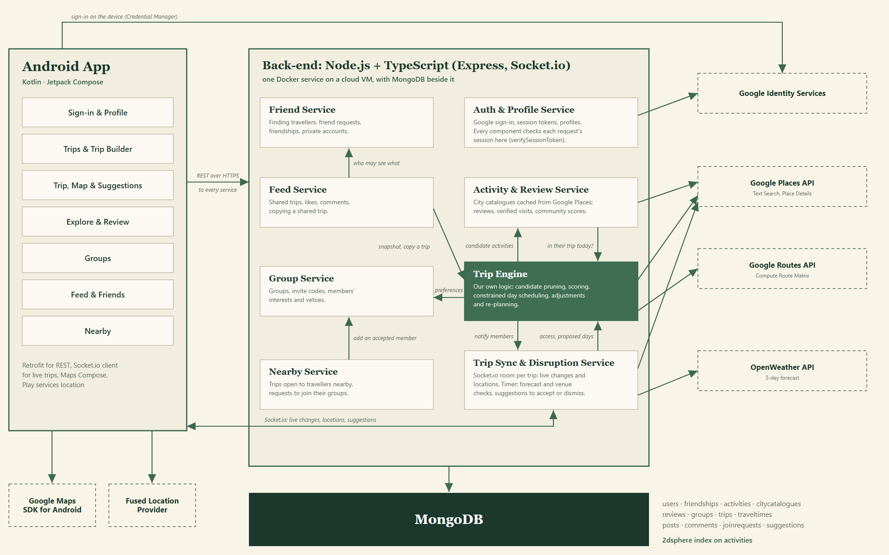

Arrows point from caller to callee, and each label names what is asked. The app calls every component's REST routes over HTTPS; the two-headed arrow is its Socket.io connection to the Trip Sync & Disruption Service. Dashed boxes are external services. Source: [`res/dependency_diagram.svg`](res/dependency_diagram.svg).

### **4.6. Use Case Sequence Diagram (5 Most Major Use Cases)**

1. [**Browse & Search Activities**](#uc1)\
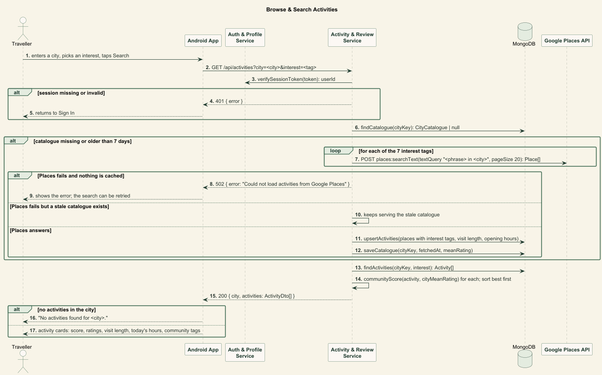
2. [**Rate & Review Activity**](#uc2)\
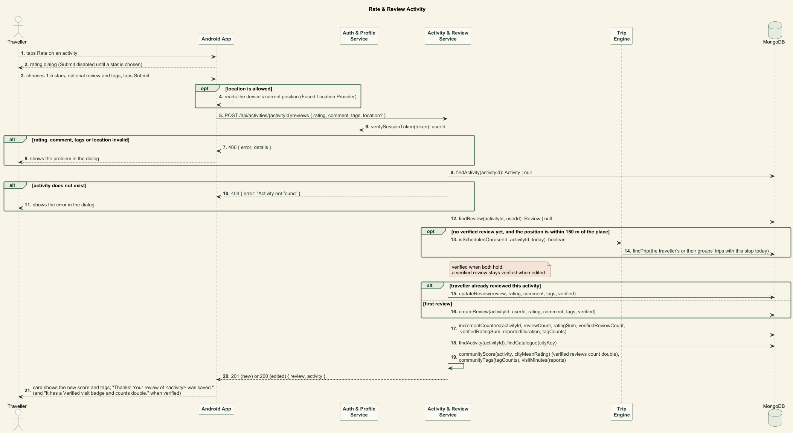
3. [**Plan Trip**](#uc3)\
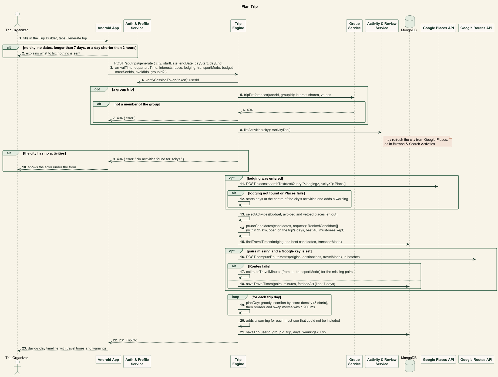
4. [**View & Adjust Trip**](#uc4)\
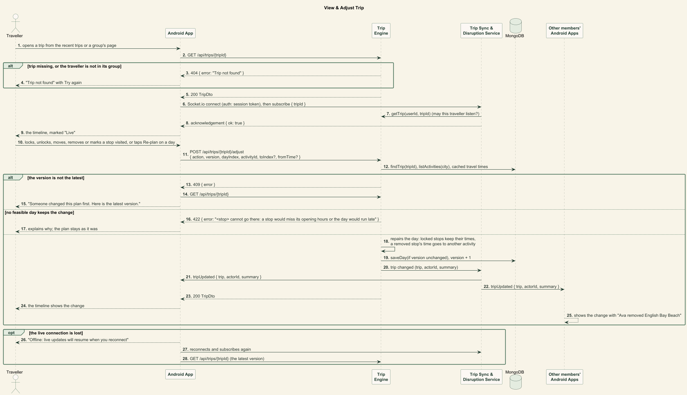
5. [**Re-plan Trip**](#uc5)\
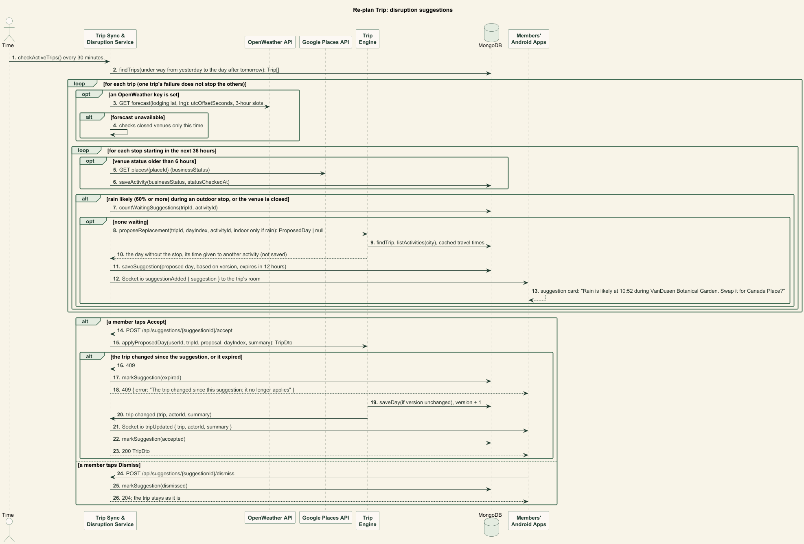

The PlantUML sources are in [`res/`](res/).

### **4.7. Design of Non-Functional Requirements**

1. [**Trip generation time**](#nfr1)
    - **Implementation**: The engine first prunes to the best 40 candidates within 25 km of the lodging that are open long enough during the trip. It builds each day by greedy insertion by score density from three starting rules, then improves it with reorder and swap moves within 200 ms per day. Travel times are loaded before the solve (from the cache or one Google Routes batch, with the offline estimate for the rest), so the solve makes no external calls. On seeded random instances it matches the brute-force optimum.
2. [**Live update latency**](#nfr2)
    - **Implementation**: Each open trip screen keeps one Socket.io connection subscribed to the trip's room. A saved change is broadcast as `tripUpdated` with the full trip, so devices re-render without another request; suggestions are pushed the same way (`suggestionAdded`).
3. [**Bounded Google Places usage**](#nfr3)
    - **Implementation**: The Activity & Review Service records each city's fetch time (`citycatalogues.fetchedAt`) and serves the stored catalogue for 7 days, fetching only on a miss or after expiry and keeping the older copy if a refresh fails. Generation reads candidates through `listActivities`, so only an entered lodging calls Places. The timer's venue-status lookups are bounded separately to once per venue every 6 hours (`activities.statusCheckedAt`).
