# Requirements and Design

## 1. Change History

| **Change Date** | **Modified Sections** | **Rationale** |
| --------------- | --------------------- | ------------- |
| 2026-10-17 | All | First version for CP1, written from the M2 presentation (features F1-F5, use case diagram, high-level design and technical challenge). |
| 2026-10-17 | 3.4, 3.5, 4.1 | In the app, Create Trip and Generate Itinerary happen on one Trip Builder screen: the trip details are saved with the itinerary they produce. A separate trip record with party members comes with Join Trip & Set Preferences (F4), so CP1 does not store trips nobody can join yet. |
| 2026-10-17 | 3.7, 4.7 | Added a third non-functional requirement, bounded Google Places usage, because the M2 design's "cache every metered call" decision needs a testable target. |
| 2026-10-26 | 3.1, 3.3, 3.4, 4.1, 4.2 | Collaborative trips are built around travel groups instead of single trips: a group holds several trips, friends join it with an invite code, and every member's interests and vetoes shape its itineraries. Join Trip & Set Preferences became Create Group, Join Group, Set Group Preferences and Leave Group, owned by a new Group Service. Groups let the same friends plan more than one trip without inviting each other again. |
| 2026-10-26 | 3.1, 3.5, 4.1, 4.4, 4.7 | View & Adjust Itinerary is implemented: any member can lock, unlock, move or remove a stop, or re-plan a day, and every member's open app receives the new plan through a Socket.io hub (Socket.io replaces plain `ws` because it is on the course's approved-library list and reconnects by itself). A locked stop keeps its time; an itinerary version number refuses edits made from an out-of-date copy, so two members editing at once never overwrite each other. |
| 2026-10-26 | 3.1, 3.4, 3.5, 4.1, 4.2, 4.3, 4.7 | Itinerary generation takes more of the traveller's wishes: how they get around (walk, transit or drive), a budget per activity, and places they must see or want to avoid. Travel times now come from Google Routes, cached for a week, with the offline estimate as the fallback. A traveller can also add a place they found in Explore to a day of a trip (new use case Add Place to Itinerary). Adding to a full day drops the lowest-ranked unlocked stops instead of refusing: the planner fills every day, so refusing would make the feature unusable. |
| 2026-10-26 | 3.1, 3.4, 3.5, 4.1, 4.2 | Added F6 Friends and the trip feed, starting with friends and private accounts: travellers find each other by name or email, send and answer friend requests, and can make their account private so only friends see their details (and, later in F6, their posts). The privacy setting belongs to a new Friend Service rather than the Auth & Profile Service, because only the Friend Service decides who sees what. The app now has a bottom navigation bar (Trips, Explore, Profile), so Browse & Search Activities starts from the Explore tab and sign-out and the profile moved to the Profile tab. |
| 2026-10-26 | 3.1, 3.4, 4.1, 4.2 | Completed F6 with the trip feed: a traveller shares a trip with a rating and caption, reads a Friends or Everyone feed (optionally for one city), likes and comments on posts, and copies a shared trip into their own trips on new dates. A post keeps a frozen copy of the plan, so later edits to the itinerary do not change what others read. Copying re-times every day for its new weekday and leaves out, with a warning, any stop that no longer fits, rather than re-planning from scratch, because the point of copying is getting the same places. A new Feed Service owns posts and comments; who may see a post is asked of the Friend Service. |
| 2026-10-26 | 3.1, 3.4, 4.1, 4.3, 4.4 | Added F7 Trip map and live location: each trip has a map of the day's stops and route, with where you are and how far the next stop is. On the trip's current day a stop is ticked off as visited when you arrive within 100 m of it, and stops can also be marked visited by hand. On a group trip, members can choose to share their position with each other while the map is open. Positions are relayed live and never stored, and nothing is tracked in the background, because a traveller's location is the most sensitive thing the app handles. |
| 2026-10-26 | 3.1, 3.4, 4.1, 4.2 | Added F8 Nearby trips: a group's owner can open a group trip to travellers nearby; a Nearby tab lists open trips with a stop within 10 km that start within a week, and a traveller can ask to join with a note, which the owner accepts or declines from the group's page. Trips are matched by their stops, and only the plan is shown, never the lodging or anyone's position, so opening a trip does not reveal where its members are. A new Nearby Service owns the requests; accepting one adds the member through the Group Service. |
| 2026-10-26 | 3.1, 3.4, 3.5, 4.1, 4.2 | Added verified reviews to F2: a review written within 150 m of the place, on a day the place is a stop of one of the reviewer's trips, gets a Verified visit badge and counts double in the community score. The app sends the device's position with a review only when location is allowed, and travellers can now read an activity's reviews, verified ones first. Verification needs both the position and the trip, so a traveller passing by, or standing at a place on another day, is not verified. |
| 2026-10-26 | 3.1, 3.4, 3.5, 4.1, 4.2, 4.3, 4.7 | F5 is implemented as suggestions rather than automatic re-plans: every 30 minutes a timer checks the forecast (OpenWeather) for outdoor stops and the venue status (Google Places) for stops of trips under way, and proposes a change for a disrupted stop (an indoor activity in the rain, another activity for a closed venue). The proposal reaches the members live and changes nothing until one of them accepts it; it lapses if the trip changes first or after 12 hours. Travellers keep control of their plan, and a wrong forecast cannot rearrange a day by itself. Push notifications (Firebase Cloud Messaging) were dropped: suggestions appear when the trip is open, which keeps the app free of background services. |

---

## 2. Project Description

Planning a trip is a scheduling problem, but every tool treats it as a search problem. Travellers find places on Google Maps, read reviews on Reddit and blogs, check each venue's opening hours on its own page, and lay the days out in a notes app. What goes wrong is predictable: the 4.8-star museum is closed on Mondays, two must-dos are 50 minutes apart and land in the same afternoon, one day ends up with nine empty hours, and nothing reasons about rating, visit length, opening hours and travel time together.

**TimeTravel** turns that into a loop. Travellers who have been to a place rate each activity and tag it (how long they stayed, the best time of day, indoor or outdoor, cost), which builds a community score per activity. A visitor then describes their trip (dates, arrival and departure times, lodging, interests and pace), and TimeTravel's own itinerary engine ranks the city's activities by score and fit and schedules them under opening hours and travel time into a day-by-day plan they can follow. The plan can be shared with the travel party and is re-planned live when things change, such as rain or a closed venue. The primary audience is short-stay leisure travellers, and also small groups travelling together; the travellers who just got back are the other side of the loop.

---

## 3. Requirements Specification

### **3.1. List of Features**

1. **F1 Sign in with Google** (implemented for CP1): Google account sign-in. The back-end verifies the Google ID token and issues its own session token. The traveller's profile keeps their home city and interest tags, which prefill searches and trips.
2. **F2 Explore & review activities** (implemented for CP1, extended for CP2): browse or search a city's activities, post a 1-5 rating, a written review and structured tags (visit length, best time of day, indoor or outdoor, cost), and read others' reviews. A review written at the place on a day it is in the traveller's trip gets a Verified visit badge and counts double.
3. **F3 Itinerary generation** (implemented for CP1, extended for CP2): dates, lodging, interests and pace in; a ranked, time-feasible, day-by-day plan out. This is our own algorithm, not a lookup. The traveller also chooses how they get around (walk, transit or drive), a budget per activity, and places they must see or want to avoid; travel times come from Google Routes. A place found in Explore can be added to a day of a trip.
4. **F4 Collaborative trips, live** (implemented for CP2): travellers form a group and invite friends with a 6-character code. Each member keeps their own interests and vetoes for the group, and the group's itineraries are planned from all of them: an interest more members share counts more, and anything a member vetoed is left out. Any member can lock, move or remove a stop or re-plan a day, and every member's open app shows the new plan within seconds.
5. **F5 Disruption-aware re-planning** (implemented for CP2): a back-end timer checks the forecast and venue status for trips under way. When rain is likely during an outdoor stop or a venue is closed, it works out a change for that part of the day and pushes it to the members as a suggestion, which they accept or dismiss; nothing changes until someone accepts.
6. **F6 Friends and the trip feed** (implemented for CP2): travellers find each other by name or email and become friends once a request is accepted. A traveller shares a trip with a rating and a caption; friends see it in their Friends feed, and everyone sees it in the Everyone feed unless the account is private. Posts can be liked, commented on, and copied into your own trips on new dates.
7. **F7 Trip map and live location** (implemented for CP2): each trip has a map of the day's stops and route with the traveller's position and the distance to the next stop. On the trip's current day, a stop is ticked off as visited when the traveller arrives within 100 m. Members of a group trip can share their position with each other while the map is open; positions are passed on live and never stored.
8. **F8 Nearby trips** (implemented for CP2): a group's owner can open a group trip to travellers nearby. Travellers see open trips with a stop within 10 km that start within the next week (the plan only, never the lodging or anyone's position) and can ask to join the group with a note; the owner accepts or declines.

How the features satisfy the project scope:

| **Project-scope requirement** | **Feature** | **How we satisfy it** |
| --- | --- | --- |
| Authentication via an external authentication service | F1 | Google Identity Services. The back-end verifies the Google ID token server-side and issues its own session token. |
| At least one feature uses an external service through an API | F2, F3 | Google Places for the activity catalogue, coordinates and opening hours, and to find the traveller's lodging. Google Routes for the travel times between stops, for the traveller's way of getting around (see 4.3). |
| At least one feature changes app content or state in response to an external event | F4, F5 | A party member's edit, a forecast change or a venue closure re-solves the affected part of the plan; the new itinerary is pushed over Socket.io and every open device re-renders. |
| At least one feature involves logic or computation we implement ourselves | F3, F5 | The Itinerary Engine: candidate pruning, scoring, and constrained day scheduling with local search (an Orienteering Problem with Time Windows). |

### **3.2. Use Case Diagram**

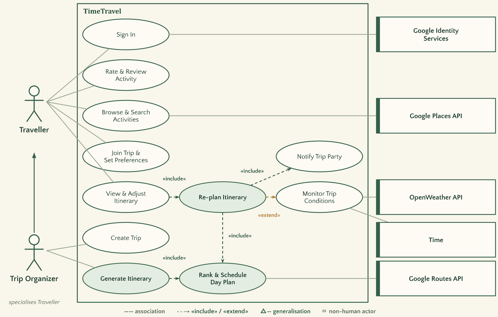

### **3.3. Actors Description**

1. **Traveller**: any app user. Browses a city's activities, rates and tags the ones they have done, joins a trip, states their interests, and follows or adjusts the itinerary while travelling.
2. **Trip Organizer**: a Traveller who also creates a group, invites friends with its code, describes a trip (dates, lodging, pace) and triggers itinerary generation. A group's owner can remove members and delete the group. Anything a Traveller can do, an Organizer can do.
3. **Google Identity Services**: authenticates the user and returns a signed ID token that our back-end verifies.
4. **Google Places API**: supplies the activity catalogue, coordinates and opening hours, and finds the traveller's lodging.
5. **Google Routes API**: supplies travel times between stops.
6. **OpenWeather API**: hourly forecast per trip day, used to detect when an outdoor activity stops being viable.
7. **Time**: the timer that triggers the periodic check of active trips' conditions.

### **3.4. Use Case Description**

- Use cases for feature 1: **Sign in with Google**
  1. **Sign In**: the traveller signs in with their Google account and stays signed in across app restarts; once signed in they can set their home city and interest tags.
- Use cases for feature 2: **Explore & review activities**
  2. **Browse & Search Activities**: the traveller looks up a city's activities, ranked by community score, optionally narrowed to one interest, and reads an activity's reviews, verified visits first.
  3. **Rate & Review Activity**: the traveller rates an activity they have done from 1 to 5 stars, optionally with a written review and structured tags, which update its community score and tags; a review written at the place on a day it is in their trip is verified and counts double.
- Use cases for feature 3: **Itinerary generation**
  4. **Create Trip**: the organizer describes the trip: destination, dates, daily hours, arrival and departure times, lodging, interests, pace, how they get around, a budget per activity, and places they must see or want to avoid.
  5. **Generate Itinerary**: the organizer asks for a plan and receives a day-by-day itinerary for the trip.
  6. **Rank & Schedule Day Plan**: the Itinerary Engine ranks candidate activities and schedules them into one day under opening hours, travel time, the day's hours and the pace. Included by Generate Itinerary and Re-plan Itinerary.
  7. **Add Place to Itinerary**: a traveller adds an activity they found in Explore to a day of one of their trips in that city; it goes where it adds the least travel, and on a full day the lowest-ranked unlocked stops make room.
- Use cases for feature 4: **Collaborative trips, live**
  8. **Create Group**: the organizer names a group and gets an invite code to share with friends.
  9. **Join Group**: a traveller types a friend's invite code and becomes a member, with their profile interests as their interests for the group.
  10. **Set Group Preferences**: a member sets their own interests for the group's trips and vetoes activities (from any group trip's stop), so the group's next plans leave them out.
  11. **Leave Group**: a member leaves, or the owner removes a member or deletes the group with its trips.
  12. **View & Adjust Itinerary**: a traveller follows the plan and locks, removes, moves or marks a stop visited; the change re-plans the affected part of the day.
  13. **Notify Trip Party**: every group member's device receives the updated plan as soon as it changes. Included by Add Place to Itinerary, View & Adjust Itinerary and Re-plan Itinerary.
- Use cases for feature 5: **Disruption-aware re-planning**
  14. **Monitor Trip Conditions**: on a timer, the system checks the forecast and venue status for each active trip's upcoming stops.
  15. **Re-plan Itinerary**: when a disruption affects a stop, the system works out a change for that day (keeping locked stops) and suggests it to the trip's members, who accept or dismiss it.
- Use cases for feature 6: **Friends and the trip feed**
  16. **Find Travellers**: a traveller searches for others by part of their name or their exact email, and opens their profile.
  17. **Manage Friends**: a traveller sends a friend request, accepts or declines one they received, cancels one they sent, or removes a friend.
  18. **Set Account Privacy**: a traveller makes their account private, so only friends see their details and posts, or public again.
  19. **Share Trip**: a traveller posts one of their trips with a 1 to 5 star rating and an optional caption; the post keeps the plan as it was when shared.
  20. **Browse Feed**: a traveller reads the Friends or Everyone feed, newest first and optionally for one city, or one traveller's posts on their page.
  21. **React to Post**: a traveller likes or unlikes a post, and adds or deletes comments; a post's author can delete the post or any comment on it.
  22. **Copy Shared Trip**: a traveller copies a shared trip into their own trips, starting on a day they choose.
- Use cases for feature 7: **Trip map and live location**
  23. **View Trip Map**: a traveller opens a trip's map and sees one day's stops in order, the route, where they are and how far the next stop is.
  24. **Tick Off Stops on Arrival**: on the trip's current day, arriving within 100 m of a stop marks it visited for everyone in the trip.
  25. **Share Location with Group**: a member of a group trip turns on sharing on the map, and the other members with the map open see where they are until they turn it off or leave.
- Use cases for feature 8: **Nearby trips**
  26. **Open Trip to Nearby Travellers**: a group's owner turns on "Open to travellers nearby" for one of the group's trips, or turns it off.
  27. **Find Nearby Trips**: a traveller opens the Nearby tab and sees open trips near where they are.
  28. **Ask to Join Trip**: a traveller asks to join an open trip's group, with an optional note to its owner.
  29. **Answer Join Request**: the group's owner accepts a request, adding the traveller to the group, or declines it.

### **3.5. Formal Use Case Specifications (5 Most Major Use Cases)**

#### Use Case 1: Browse & Search Activities

**Description**: The traveller looks up a city's activities, ranked by community score, optionally narrowed to one interest.

**Primary actor(s)**: Traveller (secondary: Google Places API)

**Main success scenario**:
1. The traveller taps Explore in the bottom navigation bar.
2. The app shows a city field prefilled with the traveller's home city, a Search button and interest filters (All, Museums, Outdoors, Food, Shopping, Landmarks, Nightlife, Family).
3. The traveller enters a city, optionally selects an interest filter, and taps Search.
4. The system loads the city's activities: from its cache, or from Google Places if the city has not been fetched in the last 7 days.
5. The app lists the activities, best community score first. Each card shows the name, interests, community score, number of Google ratings and TimeTravel reviews, typical visit length, today's opening hours and the community's most-reported tags.

**Failure scenario(s)**:
- 3a. The city field is empty.
    - 3a1. The app shows "Enter a city to explore." and does not search.
- 4a. Google Places cannot be reached and the city has never been fetched.
    - 4a1. The app shows "Could not load activities from Google Places".
    - 4a2. The traveller can tap Search again later.
- 4b. Google Places cannot be reached, but an older copy of the city is cached.
    - 4b1. The system uses the older copy and the scenario continues at step 5.
- 4c. The app cannot reach TimeTravel.
    - 4c1. The app shows "Couldn't reach TimeTravel. Check your connection and try again."
- 5a. The city has no activities.
    - 5a1. The app shows "No activities found for <city>."

#### Use Case 2: Rate & Review Activity

**Description**: A traveller who has done an activity rates it from 1 to 5 stars and can add a written review and structured tags (visit length, best time of day, indoor or outdoor, cost). This updates the activity's community score and its community tags.

**Primary actor(s)**: Traveller

**Main success scenario**:
1. On an activity's card in Explore & review, the traveller taps Rate.
2. The app opens a rating dialog with five stars, a review field and optional tag choices. Submit is disabled.
3. The traveller selects a star rating. Submit becomes enabled.
4. The traveller optionally writes a review and selects tags, then taps Submit.
5. The system saves the review, replacing the traveller's earlier review of the same activity if there is one, and recomputes the activity's community score and community tags. If the app sent the traveller's position (location is allowed), they are within 150 m of the place, and the place is a stop of one of their trips today, the review is marked verified and counts double; a verified review stays verified when edited.
6. The app closes the dialog, updates the activity's card with the new score and tags, and shows "Thanks! Your review of <activity> was saved.", adding "It has a Verified visit badge and counts double." for a verified review.

**Failure scenario(s)**:
- 4a. The traveller types more than 500 characters.
    - 4a1. The review field stops accepting characters at 500.
- 4b. The traveller taps Cancel.
    - 4b1. The dialog closes and nothing is saved.
- 5a. The activity no longer exists.
    - 5a1. The dialog shows "Activity not found" and stays open.
- 5b. The review cannot be saved because TimeTravel cannot be reached or reports an error.
    - 5b1. The dialog shows the error and stays open, so the traveller can submit again.

#### Use Case 3: Generate Itinerary

**Description**: The organizer describes a trip (destination, dates, daily hours, arrival and departure times, lodging, interests, pace, how they get around, a budget per activity, and places they must see or want to avoid) and receives a ranked, time-feasible, day-by-day plan.

**Primary actor(s)**: Trip Organizer (secondary: Google Places API, Google Routes API)

**Main success scenario**:
1. The organizer taps "Plan a trip" on the home screen.
2. The app shows the Trip Builder, with the destination prefilled from the organizer's home city and the interests from their profile.
3. The organizer enters the destination city and chooses the first and last day of the trip.
4. The organizer optionally changes the daily start and end times, sets an arrival time and a departure time, enters their lodging, and changes the interests and pace.
5. The organizer optionally chooses how they get around (Walk, Transit or Drive) and a budget per activity (Any, $ or $$), and taps "Choose places" to mark places in the destination as must-see (one tap) or avoid (two taps).
6. The organizer taps "Generate itinerary".
7. The system leaves out avoided places and places above the budget, ranks the rest by community score and interest match with must-see places first, gets travel times for the chosen way of getting around from Google Routes, and schedules the activities into each day around opening hours, travel time, the day's hours and the pace, starting and ending each day at the lodging.
8. The app shows the itinerary as a day-by-day timeline: each stop's time, name, community score and interests, the travel time between stops (for example "12 min walk"), and when the organizer is back at the lodging. The summary shows the way of getting around, the budget, and whether the travel times come from Google Routes or are estimated.

**Failure scenario(s)**:
- 3a. The destination is empty.
    - 3a1. The app shows "Enter a destination city." and does not generate.
- 3b. No dates are chosen.
    - 3b1. The app shows "Choose your trip dates." and does not generate.
- 3c. The trip is longer than 7 days.
    - 3c1. The app shows "Trips can be at most 7 days." and does not generate.
- 4a. The day ends less than 2 hours after it starts.
    - 4a1. The app shows "Your day must end at least 2 hours after it starts." and does not generate.
- 5a. The destination is empty when the organizer taps "Choose places".
    - 5a1. The app shows "Enter a destination city." and does not open the list.
- 7a. The city has no activities.
    - 7a1. The app shows "No activities found for <city>" under the form.
- 7b. The lodging cannot be found.
    - 7b1. The system plans the days from the centre of the city's activities.
    - 7b2. The itinerary shows a warning: "Could not find "<lodging>"; days start and end at the <city> centre."
- 7c. No activity fits a day (for example, the hours are outside every opening time).
    - 7c1. That day shows "Nothing fits this day. Try longer days or other interests." If no day has a stop, the itinerary also shows a warning suggesting longer days or different interests.
- 7d. A must-see place fits no day (for example, it is closed on every day of the trip).
    - 7d1. The itinerary shows a warning: "<place> did not fit your days: check its opening hours."
- 7e. Google Routes cannot be reached.
    - 7e1. The system uses its offline travel-time estimate, and the summary says "estimated travel times".
- 7f. The app cannot reach TimeTravel.
    - 7f1. The app shows "Couldn't reach TimeTravel. Check your connection and try again." and the organizer can tap "Generate itinerary" again.

#### Use Case 4: View & Adjust Itinerary

**Description**: A traveller follows a trip's itinerary and adjusts it by locking, removing or moving a stop; the change re-plans the affected part of the day and appears on every party member's device.

**Primary actor(s)**: Traveller

**Main success scenario**:
1. The traveller opens a trip from the home screen's recent trips or from its group's page.
2. The app shows the itinerary timeline, connects to the trip's live updates and shows "Live".
3. The traveller opens a stop's menu and locks, unlocks, moves (earlier or later) or removes it, or taps "Re-plan" on a day.
4. The system re-plans the affected part of the day. Locked stops keep their times; a removed stop's time goes to another activity; re-planning today keeps the stops already started.
5. Every group member's app, including the traveller's, shows the updated timeline within 2 seconds; the others also see who changed what (for example "Ava removed English Bay Beach").

**Failure scenario(s)**:
- 2a. The itinerary does not exist or the traveller is not in the trip's group.
    - 2a1. The app shows "Itinerary not found" with a Try again button.
- 2b. The live connection is lost.
    - 2b1. The app shows "Offline: live updates will resume when you reconnect."
    - 2b2. When the connection returns, the app shows "Live" again and reloads the latest itinerary.
- 4a. No feasible plan keeps the requested change (for example, a moved stop would miss its opening hours, or locked stops no longer fit).
    - 4a1. The app explains why and keeps the previous plan.
- 4b. Another member changed the itinerary after the traveller loaded it.
    - 4b1. The change is refused, the app shows "Someone changed this plan first. Here is the latest version." and reloads it.

#### Use Case 5: Re-plan Itinerary

**Description**: When the forecast turns against an outdoor stop or a venue closes, the system works out a change for that day and suggests it to the trip's members; the plan changes only when one of them accepts.

**Primary actor(s)**: Time (secondary: OpenWeather API, Google Places API)

**Main success scenario**:
1. Every 30 minutes, the system checks the stops starting in the next 36 hours of each trip under way: the forecast (a 60% chance of rain or more) for outdoor stops, and Google's business status for every stop.
2. The system detects a disruption: rain during an outdoor stop, or a venue that is closed.
3. The system works out the day without that stop, filling the time with another activity (only indoor ones in the rain) and keeping locked stops.
4. Every member with the trip open sees a suggestion card at the top of the itinerary, for example "Rain is likely at 10:52 during VanDusen Botanical Garden. Swap it for Canada Place?", with the day as it would be.
5. A member taps Accept.
6. The system saves the new day, and every member's app shows it, with "Ava accepted a suggestion: swapped VanDusen Botanical Garden for Canada Place".

**Failure scenario(s)**:
- 1a. The forecast or Google Places cannot be reached.
    - 1a1. The system skips that check, keeps the plan, and checks again at the next interval.
- 3a. No other activity fits the freed time.
    - 3a1. The suggestion offers to take the stop out and keep the time free.
- 4a. A member's device is offline or the trip is not open.
    - 4a1. The suggestion appears the next time they open the trip.
- 5a. A member taps Dismiss.
    - 5a1. The suggestion disappears and the plan stays as it is.
- 5b. Someone changed the trip after the suggestion was made, or 12 hours passed.
    - 5b1. The suggestion is no longer shown; accepting it anyway shows "The trip changed since this suggestion; it no longer applies".

### **3.6. Screen Mock-ups**

Screens from the CP1 build (demo catalogue), in the presentation's visual style:

| Sign in | Trip Builder | Itinerary | Explore & review |
| --- | --- | --- | --- |
| 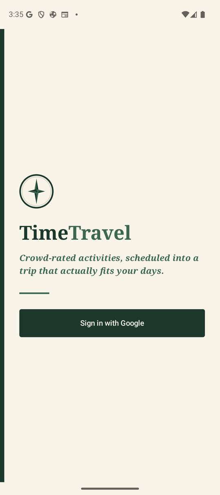 | 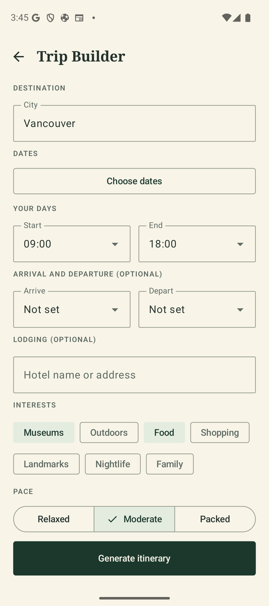 | 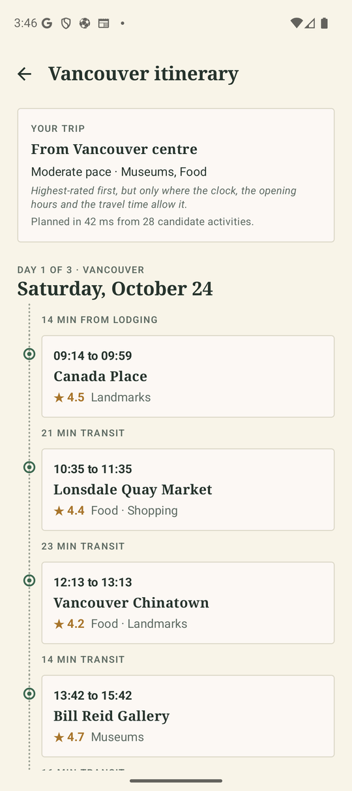 | 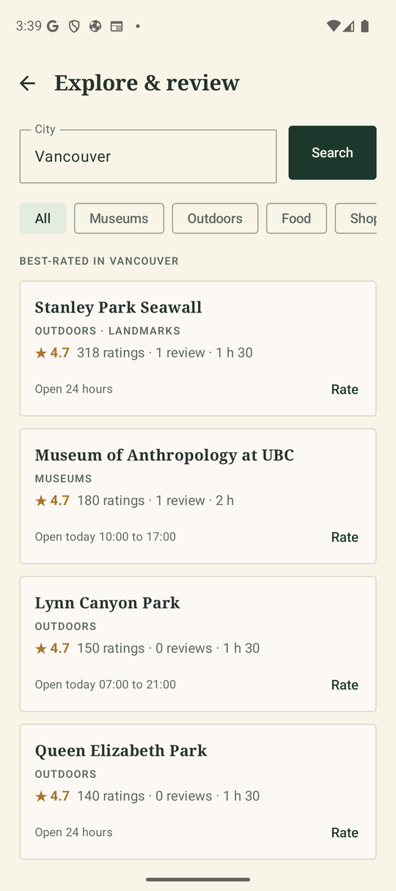 |

### **3.7. Non-Functional Requirements**

1. **Itinerary generation time**
    - **Description**: Generating a 5-day itinerary from up to 40 candidate activities takes under 3 seconds at the 95th percentile, measured at the back-end API (request received to response sent, including the database reads and write).
    - **Justification**: The organizer waits on "Generate itinerary", and the same solve re-runs on every re-plan. Nielsen's response-time limits put 1 s as the limit for an uninterrupted flow of thought and 10 s as the limit for keeping attention ([Nielsen, *Response Times: The 3 Important Limits*](https://www.nngroup.com/articles/response-times-3-important-limits/)); 3 s keeps generation clearly inside the attention limit while leaving room for travel-time lookups. Five days is a typical short-stay trip, and 40 is the candidate cap the engine prunes to.

2. **Live update latency**
    - **Description**: When an itinerary changes (a party member's adjustment or a disruption re-plan), every party member's connected device shows the new plan within 2 seconds of the change being detected.
    - **Justification**: Collaborative trips only feel shared if everyone sees the same plan while standing together; after 2 seconds people start acting on the old plan. A 2 s budget also leaves margin above the generation time of a single re-planned day.

3. **Bounded Google Places usage**
    - **Description**: Each city's activity catalogue is fetched from Google Places at most once every 7 days (one text search per interest tag, 7 in total); searching or generating itineraries for a city fetched in the last 7 days makes no Places calls.
    - **Justification**: Places requests are billed per call and the project runs on limited cloud credits. Activity catalogues change slowly, so a week-old catalogue is still accurate, while a per-search fetch would multiply cost by the number of users and searches and add Places' latency to every search.

---

## 4. Designs Specification

### **4.1. Main Components**

1. **Auth & Profile Service**
    - **Purpose**: Verifies Google ID tokens, issues TimeTravel's own session tokens, and stores the traveller's profile (home city and interest tags). It is its own component because every other component depends on its session check, and keeping Google-specific code here means no other component talks to Google Identity.
    - **Interfaces**:
        1. `POST /api/auth/google` body `{ idToken: string }` returns `{ token: string, user: UserProfile }`
            - **Purpose**: Verifies the Google ID token with Google Identity Services, creates or updates the user, and returns a 7-day session token.
        2. `GET /api/users/me` returns `UserProfile { id, email, name, homeCity, interests }`
            - **Purpose**: Returns the signed-in traveller's profile; the app also uses it to check that a stored session is still valid.
        3. `PUT /api/users/me` body `{ homeCity?: string, interests?: string[] }` returns `UserProfile`
            - **Purpose**: Sets the traveller's home city and interest tags.
        4. `String verifySessionToken(String token)`
            - **Purpose**: Called by the other components on every request; returns the user id the token was issued for, or rejects the request with 401.
2. **Activity & Review Service**
    - **Purpose**: Caches each city's activity catalogue from Google Places, stores reviews, and computes each activity's community score and community tags. We chose to cache whole city catalogues (rather than searching Places per request) to bound cost and latency (NFR 3).
    - **Interfaces**:
        1. `GET /api/activities?city=<city>&interest=<tag>` returns `{ city: string, activities: ActivityDto[] }`
            - **Purpose**: A city's activities, best community score first, optionally limited to one interest tag. `ActivityDto` is `{ id, name, address, location, interests, durationMinutes, communityTags, googleRating, googleRatingCount, reviewCount, communityScore, openingHours, cost, verifiedReviewCount }`, where `cost` is the community's cost tag, else Google's price level, else null.
        2. `POST /api/activities/{activityId}/reviews` body `{ rating: 1-5, comment?: string, tags?: { durationMinutes?, bestTimeOfDay?, cost?, setting? }, location?: { lat, lng } }` returns `{ review: ReviewDto, activity: ActivityDto }`
            - **Purpose**: Creates or edits the traveller's review of an activity and returns the activity with its updated score (201 when created, 200 when edited). With `location` within 150 m of the place, on a day the place is a stop of one of the traveller's trips (asked of the Itinerary Engine), the review is verified (`ReviewDto.verified`) and counts double in the score.
        3. `GET /api/activities/{activityId}/reviews` returns `{ reviews: ReviewListItemDto[] }`
            - **Purpose**: Up to 50 of the activity's reviews, verified ones first, then newest first, each with its author's name.
        4. `ActivityDto[] listActivities(String city, String interest)`
            - **Purpose**: Called by the Itinerary Engine to get a city's candidate activities, refreshing the catalogue from Google Places if it is older than 7 days.
3. **Itinerary Engine**
    - **Purpose**: Our own logic: candidate pruning, scoring, and constrained day scheduling. It is its own component because it is the part we tune and test hardest, so it stays independent of transport and storage (the scheduling core is a pure module with no I/O).
    - **Interfaces**:
        1. `POST /api/itineraries/generate` body `{ city, startDate, endDate, dayStart?, dayEnd?, arrivalTime?, departureTime?, interests?, pace?, lodging?, groupId?, transportMode?, budget?, mustSeeIds?, avoidIds? }` returns `ItineraryDto`
            - **Purpose**: Creates a trip and generates its itinerary. Dates are `YYYY-MM-DD` (at most 7 days), times `HH:MM`, pace one of relaxed, moderate or packed. `transportMode` is walk, transit (the default) or drive. `budget` is any (the default), low or medium; it leaves out activities whose `cost` is above it, while activities with no known cost stay in. `mustSeeIds` (up to 10) are scheduled first wherever they fit, even beyond the usual 25 km, with a warning for any that fit no day; `avoidIds` (up to 50) are left out, and no activity can be in both. Travel times among the lodging and the 12 best candidates come from Google Routes (or its cache) and the rest from the offline estimate; `travelTimeSource` in the itinerary says which. With `groupId` (the caller must be a member) the trip is the group's: the Group Service's combined interests replace `interests`, each weighted by the share of members who picked it, and every member's vetoes are left out. `ItineraryDto` holds the trip details, its `groupId` (null for a personal trip), the resolved lodging, the days (each with timed stops and travel minutes) and any warnings.
        2. `GET /api/itineraries?groupId=<id>` returns `{ itineraries: ItinerarySummary[] }`
            - **Purpose**: The traveller's 20 most recent personal and group itineraries, newest first; with `groupId`, only that group's.
        3. `GET /api/itineraries/{itineraryId}` returns `ItineraryDto`
            - **Purpose**: One of the traveller's personal itineraries, or a trip of a group they belong to (404 for anything else).
        4. `TripPlan planTrip(Candidate[] candidates, PlanRequest request, PlanOptions options)`
            - **Purpose**: The scheduling core: prunes candidates, builds each day by greedy insertion and improves it with time-budgeted local search.
        5. `POST /api/itineraries/{itineraryId}/adjust` body `{ action, version, dayIndex, activityId?, toIndex?, fromTime? }` returns `ItineraryDto`
            - **Purpose**: View & Adjust Itinerary and Add Place to Itinerary. `action` is `lock`, `unlock`, `visit`, `unvisit`, `remove`, `add`, `move` (with `toIndex`) or `replan` (with an optional `fromTime`, HH:MM). Visiting only marks the stop; the plan does not change. Adding puts an activity of the trip's city where it adds the least travel; on a full day it drops the fewest unlocked stops that make room, lowest-ranked first (409 if the activity is already in the trip, 422 if it does not fit even then). Removing keeps the other stops in order and offers the freed time to other activities; moving re-times the day and is refused (422) if a stop would miss its hours; re-planning keeps stops already started and locked stops (at their times) and re-chooses the rest. `version` must be the itinerary's current version (409 otherwise); every saved change bumps it and is passed to the Trip Sync & Disruption Service.
        6. `RoutedDay repairDay(Candidate[] kept, Candidate[] pool, DayContext context, DayRepairOptions options)`
            - **Purpose**: The scheduling core for adjustments: keeps every kept stop, fills the free time from the pool by greedy insertion from three starts, optionally reorders when that ends the day sooner, and returns null when the kept stops no longer fit.
        7. `TravelTimes forPoints(GeoPoint[] points, TransportMode mode, boolean fetchMissing)`
            - **Purpose**: Travel times between the points for one way of getting around: Google Routes times cached in the last 7 days, plus, with `fetchMissing`, the missing pairs requested from Routes in batches within its per-request limit. Every other pair, and every pair if Routes fails, uses the offline estimate. Generation fetches; adjustments use cached times only, so they never wait on Google.
        8. `TripSnapshot snapshot(String userId, String itineraryId)` and `ItineraryDto copyTrip(String userId, TripSnapshot trip, String startDate, String note)`
            - **Purpose**: Called by the Feed Service: a frozen copy of an itinerary the traveller may see, for a post; and a shared trip copied into the traveller's trips on new dates, each day re-timed for its weekday.
        9. `boolean isScheduledOn(String userId, ObjectId activityId, String date)`
            - **Purpose**: Called by the Activity & Review Service to verify a visit: whether the activity is a stop on that date of a trip the traveller may see.
        10. `ProposedDay proposeReplacement(ObjectId itineraryId, int dayIndex, String activityId, Filter allowed)` and `ItineraryDto applyProposedDay(String userId, String itineraryId, ProposedDay proposal, int dayIndex, String summary)`
            - **Purpose**: Called by the Trip Sync & Disruption Service: a day with one stop replaced (not saved), and saving such a day once a member accepts it, if the itinerary has not changed since.
4. **Group Service**
    - **Purpose**: Travel groups: members, invite codes, and each member's interests and vetoes for the group's trips. It is its own component because both the Itinerary Engine (combined preferences) and the Trip Sync & Disruption Service (who receives a group trip's updates) need the same membership answer. A group's trips belong to whoever is in the group now, so leaving a group removes access to its trips.
    - **Interfaces**:
        1. `POST /api/groups` body `{ name: string }` returns `GroupDto`
            - **Purpose**: Creates a group owned by the caller with a fresh, unique 6-character invite code. `GroupDto` is `{ id, name, inviteCode, myRole, members: [{ userId, name, role, interests, vetoedActivityIds }], createdAt }`.
        2. `GET /api/groups` returns `{ groups: GroupSummary[] }`
            - **Purpose**: The caller's groups, newest first, with each one's member count and the caller's role.
        3. `POST /api/groups/join` body `{ inviteCode: string }` returns `GroupDto`
            - **Purpose**: Adds the caller to the group with that code (any case). Joining twice changes nothing; a group holds at most 12 members (409 when full).
        4. `GET /api/groups/{groupId}` returns `GroupDto`
            - **Purpose**: A group the caller belongs to (404 for anyone else, so groups are not revealed).
        5. `PUT /api/groups/{groupId}/members/me` body `{ interests?: string[], vetoedActivityIds?: string[] }` returns `GroupDto`
            - **Purpose**: Sets the caller's own interests and vetoes for this group's trips; fields left out are unchanged.
        6. `DELETE /api/groups/{groupId}/members/{userId}` returns 204
            - **Purpose**: A member leaves (their own id), or the owner removes a member. The owner cannot leave (409); they delete the group instead.
        7. `DELETE /api/groups/{groupId}` returns 204
            - **Purpose**: The owner deletes the group and all its trips (403 for other members).
        8. `GroupTripPreferences tripPreferences(String userId, String groupId)`
            - **Purpose**: Called by the Itinerary Engine: per interest, the share of members who picked it, and every member's vetoes combined.
        9. `Group addMember(ObjectId groupId, String userId)`
            - **Purpose**: Called by the Nearby Service when an owner accepts a join request, and by joining with an invite code: adds the traveller with their profile interests in one atomic update (409 if the group is full).
        10. `GroupTripPreferences preferencesOf(ObjectId groupId)`
            - **Purpose**: The members' combined preferences without an access check, for the Itinerary Engine when the caller has already been checked or the timer is acting.
5. **Trip Sync & Disruption Service**
    - **Purpose**: A Socket.io hub on the API's own server (and TLS), with one room per itinerary, and a timer-driven watcher that detects disruption and asks the Itinerary Engine for a proposed change, which members accept or dismiss. We chose a persistent socket over polling because a change has to land on every device in seconds (NFR 2).
    - **Interfaces**:
        1. Socket.io handshake `auth: { token }`; client event `subscribe { itineraryId }` (acknowledged with `{ ok: true }` or `{ ok: false, error }`) and `unsubscribe { itineraryId }`; server event `itineraryUpdated { itinerary: ItineraryDto, actorId, summary }`
            - **Purpose**: A device subscribes to the itineraries on screen (only those its user may see) and receives every saved adjustment, with a short summary such as "Ava removed English Bay Beach". Adjustments themselves go through the REST API, so each one is validated and versioned in one place.
        2. Socket.io client events `shareLocation { itineraryId, lat, lng }` (acknowledged) and `stopSharingLocation { itineraryId }`; server events `memberLocation { itineraryId, userId, name, lat, lng, at }` and `memberLocationStopped { itineraryId, userId }`
            - **Purpose**: A device subscribed to a trip passes its position to the trip's other subscribed members. The server keeps nothing: it only relays the position, and tells the others when the device stops sharing, unsubscribes or disconnects.
        3. `void onItineraryChanged(ItineraryChange change)`
            - **Purpose**: Called by the Itinerary Engine after every saved adjustment; broadcasts it to the itinerary's room.
        4. `int checkActiveTrips()`
            - **Purpose**: Runs every 30 minutes; for trips under way, checks the forecast (outdoor stops) and venue status (at most every 6 hours per venue) for stops starting within 36 hours, and makes a suggestion for each disrupted stop. One trip's failure never stops the others being checked.
        5. `boolean suggest(ObjectId itineraryId, int dayIndex, String activityId, String reason)` and server event `suggestionAdded { suggestion: SuggestionDto }`
            - **Purpose**: Asks the Itinerary Engine for the day without the disrupted stop (only indoor replacements in the rain), saves it as a suggestion lasting 12 hours, and pushes it to the trip's room; nothing is made if one is already waiting for that stop.
        6. `GET /api/suggestions?itineraryId=<id>` returns `{ suggestions: SuggestionDto[] }`
            - **Purpose**: The trip's suggestions still waiting, oldest first, leaving out any made for an older version of the trip. `SuggestionDto` is `{ id, itineraryId, dayIndex, date, activityId, activityName, reason, message, proposedStops, createdAt, expiresAt }`.
        7. `POST /api/suggestions/{suggestionId}/accept` returns `ItineraryDto`
            - **Purpose**: Saves the proposed day if the trip is still at the version it was made from (409 otherwise, and the suggestion lapses), then pushes it to every member like any adjustment.
        8. `POST /api/suggestions/{suggestionId}/dismiss` returns 204
            - **Purpose**: Turns the suggestion down; the trip stays as it is. A suggestion is answered once (409 after that).

6. **Friend Service**
    - **Purpose**: Finding other travellers, friend requests and friendships, and each account's privacy. It is its own component because who may see a traveller's details and posts depends on both friendships and privacy, and keeping that rule in one place stops other components from each deciding it differently.
    - **Interfaces**:
        1. `GET /api/travellers?search=<text>` returns `{ travellers: TravellerDto[] }`
            - **Purpose**: Up to 20 other travellers whose name contains the text (2 to 60 characters, matched literally and ignoring case) or whose email is exactly it, by name. `TravellerDto` is `{ id, name, homeCity, isPrivate, friendship }`, where `friendship` is `self`, `none`, `requested` (the caller asked), `incoming` (they asked the caller) or `friends`, and `homeCity` is empty for a private account the caller is not friends with.
        2. `GET /api/travellers/{userId}` returns `TravellerDto` with `friendCount`
            - **Purpose**: One traveller's profile as the caller may see it (404 if there is no such traveller).
        3. `GET /api/friends` returns `{ isPrivate, friends: TravellerDto[], incoming: TravellerDto[], outgoing: TravellerDto[] }`
            - **Purpose**: The caller's friends, the requests they received and sent, by name, and their own privacy setting.
        4. `POST /api/friends/requests` body `{ userId }` returns `TravellerDto`
            - **Purpose**: Sends a friend request (201). If that traveller already asked the caller, this accepts their request instead; asking again or asking a friend changes nothing (both 200). Asking yourself is refused (400).
        5. `POST /api/friends/requests/{userId}/accept` returns `TravellerDto`
            - **Purpose**: Accepts the request that traveller sent the caller (404 if there is none).
        6. `DELETE /api/friends/{userId}` returns 204
            - **Purpose**: Removes the friendship or request between the caller and that traveller, whichever exists: unfriending, cancelling a sent request and declining a received one are the same call (404 if there is nothing to remove).
        7. `PUT /api/friends/privacy` body `{ isPrivate: boolean }` returns `{ isPrivate }`
            - **Purpose**: Makes the caller's account private or public.
        8. `Audience audience(String viewerId)` and `boolean canSee(String viewerId, String authorId)`
            - **Purpose**: Called by the Feed Service: whose posts the viewer may see (their own and their friends' always, anyone else's only if the account is public).

7. **Feed Service**
    - **Purpose**: Shared trips (posts), their likes and comments, and copying a shared trip. It is its own component because posts outlive the itineraries they were shared from and have their own access rule (the Friend Service's), so keeping them out of the Itinerary Engine keeps that component about planning.
    - **Interfaces**:
        1. `POST /api/posts` body `{ itineraryId, rating: 1-5, caption? }` returns `PostDetailDto`
            - **Purpose**: Shares a frozen copy of an itinerary the caller may see (201), with a caption of up to 500 characters; a trip with no stops is refused (422). `PostDto` is `{ id, author: { id, name }, city, startDate, endDate, dayCount, stopCount, rating, caption, likeCount, likedByMe, commentCount, mine, createdAt }`; `PostDetailDto` adds `trip` (day hours, pace, way of getting around, budget, interests, lodging and the timed stops of each day).
        2. `GET /api/posts?feed=friends|everyone&city=<city>&authorId=<id>&before=<ISO time>` returns `{ posts: PostDto[] }`
            - **Purpose**: 20 posts at a time, newest first. `friends` is the caller's and their friends' posts; `everyone` (the default) is every post except those of private accounts the caller is not friends with. `city` filters by city ignoring case, `authorId` lists one traveller's posts (none if the caller may not see them), and `before` gives the next page.
        3. `GET /api/posts/{postId}` returns `PostDetailDto`
            - **Purpose**: One post in full, if the caller may see it (404 otherwise, so private accounts' posts are not revealed).
        4. `DELETE /api/posts/{postId}` returns 204
            - **Purpose**: The author deletes their post and its comments (403 for anyone else). The itinerary it came from is not affected.
        5. `PUT /api/posts/{postId}/like` and `DELETE /api/posts/{postId}/like` return `{ likeCount, likedByMe }`
            - **Purpose**: Likes or unlikes the post; doing either twice changes nothing.
        6. `GET /api/posts/{postId}/comments` returns `{ comments: CommentDto[] }`
            - **Purpose**: The post's comments, oldest first (up to 100). `CommentDto` is `{ id, author: { id, name }, text, mine, createdAt }`.
        7. `POST /api/posts/{postId}/comments` body `{ text }` returns `CommentDto`
            - **Purpose**: Adds a comment of 1 to 300 characters (201).
        8. `DELETE /api/posts/{postId}/comments/{commentId}` returns 204
            - **Purpose**: The comment's author or the post's author deletes a comment (403 for anyone else).
        9. `POST /api/posts/{postId}/copy` body `{ startDate }` returns `ItineraryDto`
            - **Purpose**: Copies the shared trip into the caller's own trips starting on `startDate` (201). Each day keeps its stops in order, re-timed for its new weekday with the Itinerary Engine's `copyTrip`; a stop that no longer fits is left out with a warning.

8. **Nearby Service**
    - **Purpose**: Group trips opened to travellers nearby, and requests to join their groups. It is its own component because it joins two concerns, where a trip is and who may join a group, under one privacy rule: nearby travellers see a trip's plan and nothing about where its members stay or are.
    - **Interfaces**:
        1. `PUT /api/nearby/trips/{itineraryId}` body `{ openToJoin: boolean }` returns `{ openToJoin }`
            - **Purpose**: The group's owner opens a group trip to travellers nearby, or closes it (403 for other members, 409 for a personal trip).
        2. `GET /api/nearby/trips?lat=<lat>&lng=<lng>` returns `{ trips: NearbyTripDto[] }`
            - **Purpose**: Up to 20 open trips, nearest first, with a stop within 10 km of the position that have not ended and start within 7 days, leaving out the caller's own groups. `NearbyTripDto` is `{ itineraryId, groupId, groupName, organizer, memberCount, city, startDate, endDate, stopNames, interests, distanceKm, myRequest }`; it never includes the lodging or any member's position.
        3. `POST /api/nearby/trips/{itineraryId}/requests` body `{ note? }` returns `JoinRequestDto`
            - **Purpose**: Asks to join the trip's group with a note of up to 200 characters (201); refused if the trip is not open (404), the caller is already a member (409), or already has a pending request (409). `JoinRequestDto` is `{ id, itineraryId, groupId, requester: { id, name }, note, status, createdAt }`.
        4. `GET /api/nearby/requests?groupId=<id>` returns `{ requests: JoinRequestDto[] }`
            - **Purpose**: The group's pending requests, oldest first; owner only (403 for other members).
        5. `POST /api/nearby/requests/{requestId}/accept` and `POST /api/nearby/requests/{requestId}/decline` return `JoinRequestDto`
            - **Purpose**: The group's owner answers a pending request once (409 after that); accepting adds the traveller to the group through the Group Service (409 if the group is full).

### **4.2. Databases**

1. **MongoDB** (one database, accessed through Mongoose)
    - **Purpose**: Stores `users` (Google identity, home city, interests, whether the account is private), `friendships` (who asked whom, pending or accepted, with the two user ids in sorted order under a unique index, so two travellers never have two friendships), `activities` (the cached catalogue, with a 2dsphere index on location for "near my lodging" queries and the review counters, verified reviews counted separately), `citycatalogues` (when each city was last fetched from Places, for cache expiry), `reviews` (each marked verified or not), `groups` (name, unique invite code, and each member's role, interests and vetoes, indexed by member), `itineraries` (one document per trip with its days and stops (each stop marked locked or visited), its options, the group's id for a group trip, and whether it is open to travellers nearby), `joinrequests` (who asked to join which group through which trip, their note and the answer), `suggestions` (the proposed day for a disrupted stop, the version it was made from, its answer and when it lapses), `traveltimes` (Google Routes travel times per way of getting around and pair of points, deleted by a time-to-live index a week after they were fetched), `posts` (the author, a frozen copy of the trip, the rating and caption, and who liked it, indexed for the feed by time, author and city), and `comments` (indexed by post).
    - **Why MongoDB, not MySQL**: an itinerary is one nested, variable-shaped document per trip, and we need 2dsphere geo queries on activities. A relational schema would join five tables to read a single day.

### **4.3. External Modules**

1. **Google Identity Services**
    - **Purpose**: Signs the traveller in on the device (Credential Manager) and issues the Google ID token that the Auth & Profile Service verifies server-side.
2. **Google Places API (New), Text Search**
    - **Purpose**: Supplies each city's activities (name, address, coordinates, types, rating, opening hours) and finds the traveller's lodging; for stops of trips under way, Place Details gives each venue's business status (asked at most every 6 hours per venue).
3. **Google Routes API, Compute Route Matrix**
    - **Purpose**: Travel times by walking, transit or driving among the lodging and the best candidates, requested in batches within Google's per-request limit (100 pairs for transit, 625 otherwise) and cached in MongoDB for a week. Whenever Routes fails or the quota runs out, the engine falls back to an offline estimate (straight-line distance times a detour factor, at walking, transit or driving speed), so the planner degrades instead of failing.
4. **Google Maps SDK for Android**
    - **Purpose**: Draws the trip map (tiles, markers and the route) in the app, with a key restricted to the app's package and signing certificates.
5. **Fused Location Provider** (Google Play services)
    - **Purpose**: The traveller's position while the trip map is open, every 10 seconds or 10 metres, for the distance to the next stop, ticking off stops on arrival, and sharing with the group.
6. **OpenWeather API, 5-day forecast**
    - **Purpose**: The forecast in 3-hour steps at a trip's lodging, with the place's UTC offset, used to tell when rain is likely during an outdoor stop. Without a key, only closed venues are checked.

### **4.4. Frameworks and Libraries**

Back-end:
1. **Express 5**
    - **Purpose**: HTTP server and routing for the REST API.
    - **Reason**: the course's standard Node.js web framework; Express 5 also forwards errors thrown in async handlers to the error handler.
2. **Mongoose 8**
    - **Purpose**: MongoDB schemas, validation and queries.
    - **Reason**: typed schemas with validation and 2dsphere index support, and the most widely used MongoDB library for Node.js.
3. **zod**
    - **Purpose**: Validates request bodies and query strings.
    - **Reason**: one schema gives both validation with readable error details and the TypeScript type of the validated input.
4. **google-auth-library**
    - **Purpose**: Verifies Google ID tokens.
    - **Reason**: Google's official library; it checks the signature, audience and expiry.
5. **jsonwebtoken**
    - **Purpose**: Signs and verifies TimeTravel session tokens.
    - **Reason**: standard, stateless session tokens, so the back-end does not keep a session table.
6. **Socket.io** (server, and `io.socket:socket.io-client` in the app)
    - **Purpose**: The live connection of the Trip Sync & Disruption Service: authentication on connect, one room per itinerary, acknowledgements, and automatic reconnection.
    - **Reason**: on the course's approved-library list for live updates, and its rooms and reconnection would otherwise have to be written by hand on top of plain WebSockets.
7. **Jest, Supertest and mongodb-memory-server**
    - **Purpose**: Back-end interface, unit and non-functional tests.
    - **Reason**: Jest is the course's testing framework; Supertest drives the Express app in-process; mongodb-memory-server gives every test run a real, throwaway MongoDB without Docker.

Front-end:
1. **Jetpack Compose with Material 3**
    - **Purpose**: All screens.
    - **Reason**: required by the course; Material 3 theming lets the app use the presentation's palette, serif headings and squarer shapes.
2. **Navigation Compose and Lifecycle ViewModel**
    - **Purpose**: Screen navigation and screen state that survives configuration changes.
    - **Reason**: the standard Jetpack architecture for Compose apps.
3. **Retrofit with Gson, on OkHttp**
    - **Purpose**: Calls the REST API; OkHttp adds the session token to every request.
    - **Reason**: the most common type-safe HTTP client for Android, and the one named in the M2 design.
4. **Maps Compose and Play services location**
    - **Purpose**: The trip map screen and the device's position.
    - **Reason**: Maps Compose is Google's Compose wrapper for the Maps SDK, so the map is built like every other screen; the fused location provider gives accurate positions with less battery than reading GPS directly.
5. **Credential Manager with the Google ID library**
    - **Purpose**: "Sign in with Google" on the device, including adding an account when none is signed in.
    - **Reason**: Android's current recommended sign-in API, replacing the deprecated Google Sign-In for Android.

Deployment: **Docker Compose** runs the back-end and MongoDB together on a cloud VM.

### **4.5. Dependencies Diagram**

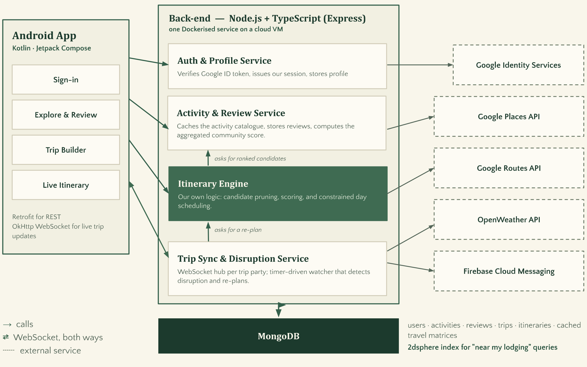

Arrows show call dependencies (A calls B through an interface defined in B); the two-headed arrow between the app and the Trip Sync & Disruption Service is the WebSocket, used in both directions. The Itinerary Engine calls the Activity & Review Service for ranked candidates, and the Trip Sync & Disruption Service calls the Itinerary Engine for re-plans. Dashed boxes are external services.

### **4.6. Use Case Sequence Diagram (5 Most Major Use Cases)**

1. [**Browse & Search Activities**](#uc1)\
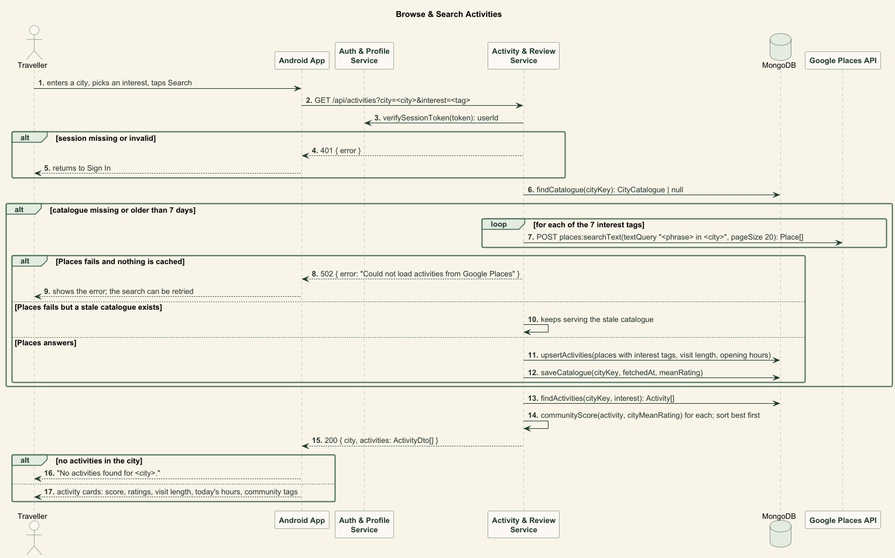
2. [**Rate & Review Activity**](#uc2)\
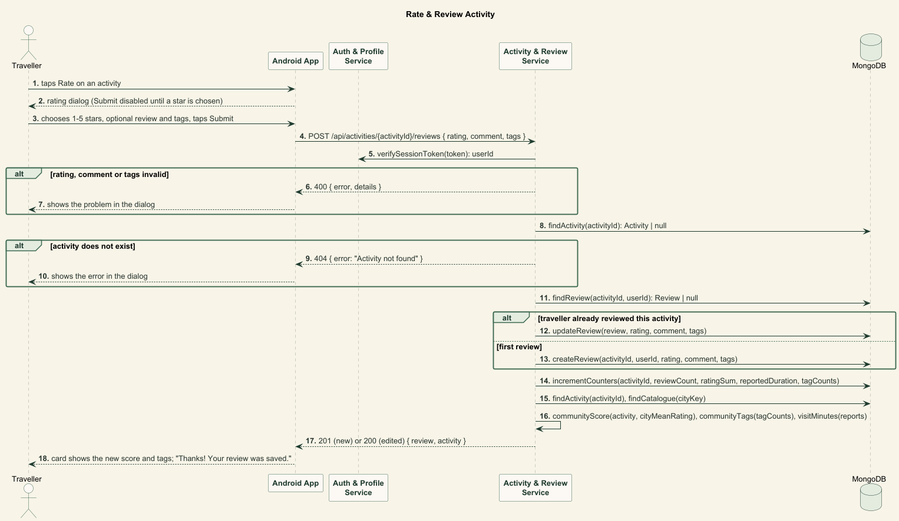
3. [**Generate Itinerary**](#uc3)\
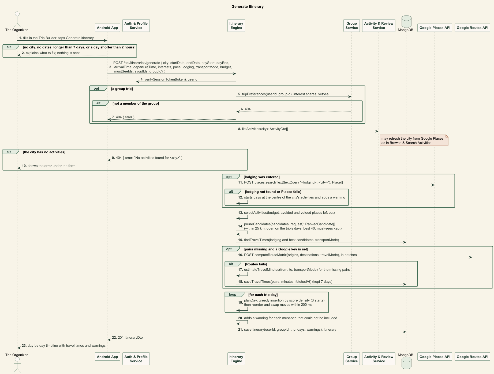
4. [**View & Adjust Itinerary**](#uc4)\
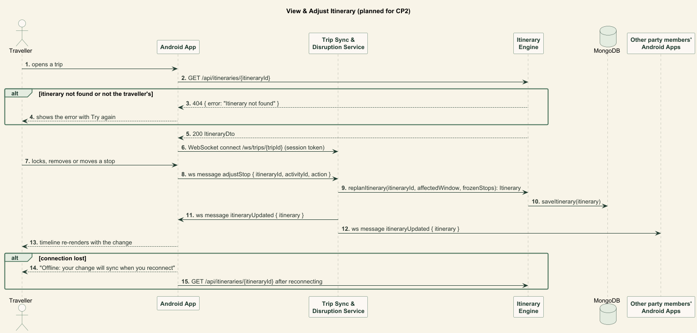
5. [**Re-plan Itinerary**](#uc5)\
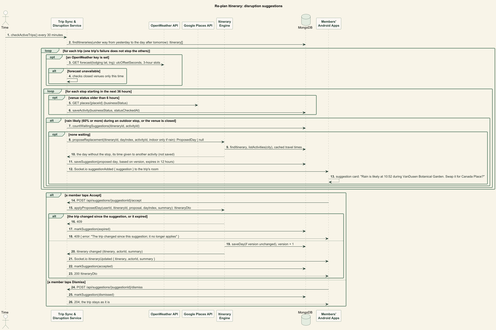

The PlantUML sources of these diagrams are in [`res/`](res/).

### **4.7. Design of Non-Functional Requirements**

1. [**Itinerary generation time**](#nfr1)
    - **Implementation**: The engine first shrinks the problem: it drops activities more than 25 km from the lodging or never open long enough during the trip, and keeps the best 40 by community score times interest match. Each day is then built by greedy insertion by score density (score per minute of visit plus added travel) from three starting rules, and each result is improved by reorder (2-opt and relocation) and swap moves within a fixed budget of 200 ms per day; travel times among the lodging and the 12 best candidates are read from the cache or fetched from Google Routes in one batch before the solve, and the offline estimate covers every other pair, so no external call happens inside the solve. On seeded random instances the planner matches the brute-force optimum.
2. [**Live update latency**](#nfr2)
    - **Implementation**: Each open itinerary screen keeps one Socket.io connection to the Trip Sync & Disruption Service, subscribed to that itinerary's room; as soon as an adjustment is saved, the service broadcasts `itineraryUpdated` with the full itinerary, so devices re-render without a second request. Disruption suggestions are pushed the same way (`suggestionAdded`), and accepting one is saved and broadcast like any adjustment.
3. [**Bounded Google Places usage**](#nfr3)
    - **Implementation**: The Activity & Review Service records when each city was fetched (`citycatalogues.fetchedAt`) and serves the stored catalogue for 7 days, running one text search per interest tag only on a miss or after expiry. If a refresh fails, it keeps serving the older catalogue. The Itinerary Engine gets candidates through `listActivities`, so generating itineraries never calls Places for activities; only an entered lodging triggers one lookup. The disruption timer's venue-status lookups are separate and bounded too: only for stops of trips under way, at most once per venue every 6 hours (`activities.statusCheckedAt`).
