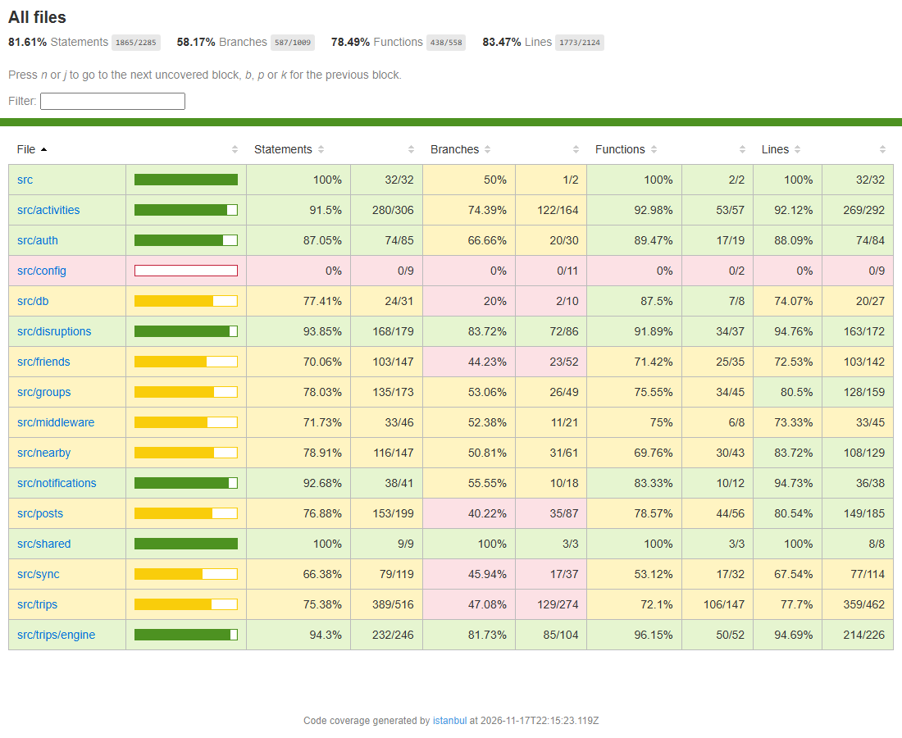
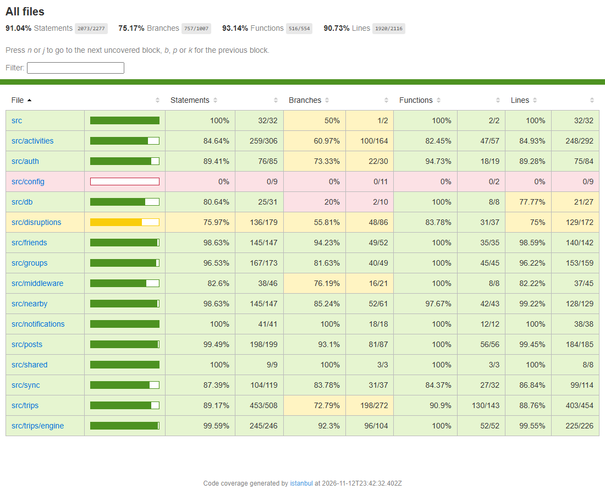
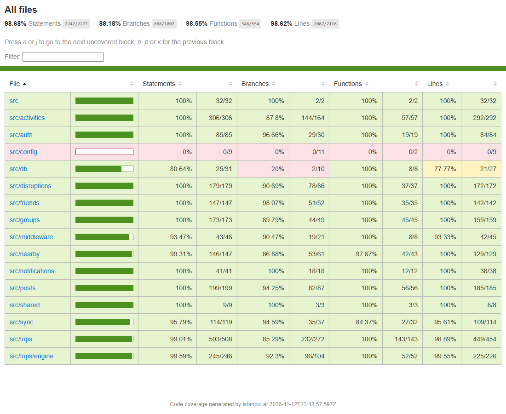

# Testing

## 1. Change History

| **Change Date** | **Modified Sections** | **Rationale** |
| --------------- | --------------------- | ------------- |
| 2026-10-17 | All | First version for CP1: interface tests for the Auth & Profile Service, Activity & Review Service and Itinerary Engine, the NFR 1 test, and the Generate Itinerary end-to-end test design. |
| 2026-10-26 | 2.1.1 | Added the Group Service interfaces and group trips in the Itinerary Engine interfaces. |
| 2026-10-26 | 2.1.1, 3 | Added the adjust interface, Socket.io live updates, and the NFR 2 test with its log. |
| 2026-10-26 | 2.1.1 | Added trip options to the generate tests (Google Routes mocked and through the production client) and the `add` adjustment. |
| 2026-10-26 | 2.1.1 | Added the Friend Service interfaces. |
| 2026-10-26 | 2.1.1 | Added the Feed Service interfaces; copying is also tested with Google Routes mocked. |
| 2026-10-26 | 2.1.1 | Added the `visit` and `unvisit` adjustments and Socket.io location sharing. |
| 2026-10-26 | 2.1.1 | Added the Nearby Service interfaces. |
| 2026-10-26 | 2.1.1 | Added verified reviews and the reviews list interface. |
| 2026-10-26 | 2.1.1 | Added the suggestion interfaces, the disruption timer (OpenWeather and Places mocked and through the production clients) and the `suggestionAdded` push. |
| 2026-10-26 | 2.1.1, 2.3-2.5, 3, 4 | Added three unmocked tests and regenerated coverage, with uncovered lines now mapped to the TypeScript source. Added the NFR 3 test, and implemented the three end-to-end tests with their logs. |
| 2026-10-27 | 4.2 | The Generate Itinerary test's unknown lodging is now "no such place zzzz", because Google Places matched the old one to real Vancouver hotels. |
| 2026-11-02 | All | Shortened the wording after CP1 feedback, and renumbered the Generate Itinerary test steps to match the CP2 use case. |
| 2026-11-12 | 2.1, 2.5, 3, 4 | Renamed itineraries to trips in the interfaces, test files and end-to-end tests (`PlanTripTest`, `ViewAdjustTripTest`) to match the code. |
| 2026-11-12 | 2.1.1 | Added the tests for losing access to a group trip (`tripAccessLost`), which fix the peer review's major fault. |
| 2026-11-12 | 2.1.1 | Added the live event interfaces (`liveEvent`) for friends, groups, join requests, posts and suggestions. |
| 2026-11-12 | 2.1.1 | Added the Notification Service interfaces (`GET /api/notifications`, `POST /api/notifications/read`). |
| 2026-11-12 | 2.1.1 | Plan Trip's interface tests now check that every stop is on the 15-minute grid. |
| 2026-11-12 | 2.1.1 | The suggestion interface tests check the proposed day used for the preview, and Dismiss became Decline. |
| 2026-11-12 | 2.1.1 | Added the tests for copied trips joining their original's card, and for who took a trip. |
| 2026-11-12 | 2.1.1 | Added tests for the peer review's code-review fixes: Google unavailable at sign-in, reviews and joins sent twice at once, partial city searches, and a failed venue check. |
| 2026-11-12 | 2.1.1, 3, 4.2 | Added what the peer review's test review asked for: expired-session and 7-day-session tests, the order of the reviews list, `parsePort`, NFR 3 while Google fails, an app test timing NFR 2 on the phone, Plan Trip split into one test per scenario, a unique review per run, and comments on the unit tests. |
| 2026-11-12 | 2.3, 2.4, 2.5, 3.2 | Completed for CP3: new coverage screenshots and the reasons for every uncovered line, and this commit's NFR logs. The text coverage tables were removed, since they only repeated the screenshots. |
| 2026-11-12 | 3.2, 4.2 | The Android test logs come from the redesigned app: the tests find the same tags and labels, so none changed. |
| 2026-11-17 | 4.2 | Removed the Plan Trip test for an unknown lodging (7b): Google Places now matches its made-up lodging to a real place, so it failed against the deployed back-end. |
| 2026-11-17 | 2.1.1, 3, 4.2 | Added the tests of `DELETE /api/trips/:tripId`, renamed NFR 3 to Google Places cost, and made Cancel in Rate & Review a step of the main scenario, after CP2 feedback that it is not a failure. |
| 2026-11-17 | 2.1.2, 2.3, 2.4, 2.5, 3.2 | Recorded the back-end run on `d7fdffb`, the commit with Delete Trip: its coverage screenshots, the uncovered lines of `tripService.ts` (moved by the new code) and the NFR 1 and NFR 2 logs. |

---

## 2. Back-end Test Specification: APIs

### 2.1. Locations of Back-end Tests and Instructions to Run Them

#### 2.1.1. Tests

| **Interface** | **Describe Group Location, No Mocks** | **Describe Group Location, With Mocks** | **Mocked Components** |
| --- | --- | --- | --- |
| **POST /api/auth/google** | [`backend/tests/no-mock/auth.test.ts#L18`](../backend/tests/no-mock/auth.test.ts#L18) | [`backend/tests/mock/auth.test.ts#L29`](../backend/tests/mock/auth.test.ts#L29) | Google Identity Services (token verification), User DB |
| **GET /api/users/me** | [`backend/tests/no-mock/auth.test.ts#L83`](../backend/tests/no-mock/auth.test.ts#L83) | [`backend/tests/mock/auth.test.ts#L194`](../backend/tests/mock/auth.test.ts#L194) | User DB |
| **PUT /api/users/me** | [`backend/tests/no-mock/auth.test.ts#L193`](../backend/tests/no-mock/auth.test.ts#L193) | [`backend/tests/mock/auth.test.ts#L216`](../backend/tests/mock/auth.test.ts#L216) | User DB |
| **GET /api/activities** | [`backend/tests/no-mock/activities.test.ts#L22`](../backend/tests/no-mock/activities.test.ts#L22) | [`backend/tests/mock/activities.test.ts#L46`](../backend/tests/mock/activities.test.ts#L46), [`#L201`](../backend/tests/mock/activities.test.ts#L222) (through the production Google Places client) | Google Places API, Activity DB |
| **POST /api/activities/:activityId/reviews** | [`backend/tests/no-mock/reviews.test.ts#L56`](../backend/tests/no-mock/reviews.test.ts#L56) | [`backend/tests/mock/reviews.test.ts#L28`](../backend/tests/mock/reviews.test.ts#L28) | Review DB, Activity DB, City catalogue DB |
| **GET /api/activities/:activityId/reviews** | [`backend/tests/no-mock/reviews.test.ts#L334`](../backend/tests/no-mock/reviews.test.ts#L334) | [`backend/tests/mock/reviews.test.ts#L180`](../backend/tests/mock/reviews.test.ts#L180) | Review DB |
| **POST /api/groups** | [`backend/tests/no-mock/groups.test.ts#L23`](../backend/tests/no-mock/groups.test.ts#L23) | [`backend/tests/mock/groups.test.ts#L25`](../backend/tests/mock/groups.test.ts#L25) | Group DB (invite-code collisions, write failures) |
| **GET /api/groups** | [`backend/tests/no-mock/groups.test.ts#L73`](../backend/tests/no-mock/groups.test.ts#L73) | [`backend/tests/mock/groups.test.ts#L78`](../backend/tests/mock/groups.test.ts#L78) | Group DB |
| **POST /api/groups/join** | [`backend/tests/no-mock/groups.test.ts#L116`](../backend/tests/no-mock/groups.test.ts#L116) | [`backend/tests/mock/groups.test.ts#L97`](../backend/tests/mock/groups.test.ts#L97) | Group DB |
| **GET /api/groups/:groupId** | [`backend/tests/no-mock/groups.test.ts#L226`](../backend/tests/no-mock/groups.test.ts#L226) | [`backend/tests/mock/groups.test.ts#L137`](../backend/tests/mock/groups.test.ts#L137) | Group DB |
| **PUT /api/groups/:groupId/members/me** | [`backend/tests/no-mock/groups.test.ts#L264`](../backend/tests/no-mock/groups.test.ts#L264) | [`backend/tests/mock/groups.test.ts#L156`](../backend/tests/mock/groups.test.ts#L156) | Group DB (member removed during the update) |
| **DELETE /api/groups/:groupId/members/:userId** | [`backend/tests/no-mock/groups.test.ts#L323`](../backend/tests/no-mock/groups.test.ts#L323) | [`backend/tests/mock/groups.test.ts#L176`](../backend/tests/mock/groups.test.ts#L176) | Group DB |
| **DELETE /api/groups/:groupId** | [`backend/tests/no-mock/groups.test.ts#L396`](../backend/tests/no-mock/groups.test.ts#L396) | [`backend/tests/mock/groups.test.ts#L198`](../backend/tests/mock/groups.test.ts#L198) | Trip DB |
| **POST /api/trips/generate** | [`backend/tests/no-mock/trips.test.ts#L38`](../backend/tests/no-mock/trips.test.ts#L38) | [`backend/tests/mock/trips.test.ts#L37`](../backend/tests/mock/trips.test.ts#L37), [`#L198`](../backend/tests/mock/trips.test.ts#L198) (Google Routes travel times, cache and failures), [`#L284`](../backend/tests/mock/trips.test.ts#L284) (through the production Google Routes client) | Google Places API (lodging lookup), Google Routes API, Trip DB |
| **GET /api/trips/:tripId** | [`backend/tests/no-mock/trips.test.ts#L410`](../backend/tests/no-mock/trips.test.ts#L410) | [`backend/tests/mock/trips.test.ts#L136`](../backend/tests/mock/trips.test.ts#L136) | Trip DB |
| **GET /api/trips** | [`backend/tests/no-mock/trips.test.ts#L459`](../backend/tests/no-mock/trips.test.ts#L459) | [`backend/tests/mock/trips.test.ts#L157`](../backend/tests/mock/trips.test.ts#L157) | Trip DB |
| **DELETE /api/trips/:tripId** | [`backend/tests/no-mock/deleteTrip.test.ts#L16`](../backend/tests/no-mock/deleteTrip.test.ts#L16) | [`backend/tests/mock/deleteTrip.test.ts#L18`](../backend/tests/mock/deleteTrip.test.ts#L18) | Trip DB |
| **POST /api/trips/:tripId/adjust** | [`backend/tests/no-mock/adjust.test.ts#L41`](../backend/tests/no-mock/adjust.test.ts#L41) | [`backend/tests/mock/adjust.test.ts#L32`](../backend/tests/mock/adjust.test.ts#L32) | Trip DB (a concurrent change saved first, write failure), Activity DB, live-update push |
| **Socket.io trip updates** | [`backend/tests/no-mock/tripSync.test.ts#L41`](../backend/tests/no-mock/tripSync.test.ts#L41) | [`backend/tests/mock/tripSync.test.ts#L22`](../backend/tests/mock/tripSync.test.ts#L22) | Trip DB (access check on subscribe) |
| **Socket.io location sharing** | [`backend/tests/no-mock/tripSync.test.ts#L150`](../backend/tests/no-mock/tripSync.test.ts#L150) | [`backend/tests/mock/tripSync.test.ts#L49`](../backend/tests/mock/tripSync.test.ts#L49) | User DB (looking up the sharer) |
| **Socket.io suggestions** | [`backend/tests/no-mock/tripSync.test.ts#L321`](../backend/tests/no-mock/tripSync.test.ts#L321) | [`backend/tests/mock/tripSync.test.ts#L78`](../backend/tests/mock/tripSync.test.ts#L78) | Suggestion push (a device that cannot be reached) |
| **Socket.io losing access to a group trip** | [`backend/tests/no-mock/tripSync.test.ts#L236`](../backend/tests/no-mock/tripSync.test.ts#L236) | [`backend/tests/mock/tripSync.test.ts#L104`](../backend/tests/mock/tripSync.test.ts#L104) | Trip access check (a traveller removed but still subscribed), membership push (a device that cannot be reached) |
| **Socket.io live events for friends** | [`backend/tests/no-mock/liveEvents.test.ts#L58`](../backend/tests/no-mock/liveEvents.test.ts#L58) | [`backend/tests/mock/liveEvents.test.ts#L17`](../backend/tests/mock/liveEvents.test.ts#L17) | Live event push (a device that cannot be reached), name lookup (the User DB fails) |
| **Socket.io live events for groups** | [`backend/tests/no-mock/liveEvents.test.ts#L107`](../backend/tests/no-mock/liveEvents.test.ts#L107) | Covered by the mocked tests for friends | None |
| **Socket.io live events for join requests** | [`backend/tests/no-mock/liveEvents.test.ts#L150`](../backend/tests/no-mock/liveEvents.test.ts#L150) | Covered by the mocked tests for friends | None |
| **Socket.io live events for posts** | [`backend/tests/no-mock/liveEvents.test.ts#L189`](../backend/tests/no-mock/liveEvents.test.ts#L189) | Covered by the mocked tests for friends | None |
| **Socket.io live events for suggestions** | [`backend/tests/no-mock/liveEvents.test.ts#L222`](../backend/tests/no-mock/liveEvents.test.ts#L222) | Covered by the mocked tests for friends | None |
| **GET /api/notifications** | [`backend/tests/no-mock/notifications.test.ts#L48`](../backend/tests/no-mock/notifications.test.ts#L48) | [`backend/tests/mock/notifications.test.ts#L19`](../backend/tests/mock/notifications.test.ts#L19) | Notification DB (reading, and storing a live event) |
| **POST /api/notifications/read** | [`backend/tests/no-mock/notifications.test.ts#L114`](../backend/tests/no-mock/notifications.test.ts#L114) | [`backend/tests/mock/notifications.test.ts#L60`](../backend/tests/mock/notifications.test.ts#L60) | Notification DB (marking read) |
| **GET /api/travellers** | [`backend/tests/no-mock/friends.test.ts#L37`](../backend/tests/no-mock/friends.test.ts#L37) | [`backend/tests/mock/friends.test.ts#L33`](../backend/tests/mock/friends.test.ts#L33) | User DB |
| **GET /api/travellers/:userId** | [`backend/tests/no-mock/friends.test.ts#L133`](../backend/tests/no-mock/friends.test.ts#L133) | [`backend/tests/mock/friends.test.ts#L51`](../backend/tests/mock/friends.test.ts#L51) | Friendship DB |
| **GET /api/friends** | [`backend/tests/no-mock/friends.test.ts#L186`](../backend/tests/no-mock/friends.test.ts#L186) | [`backend/tests/mock/friends.test.ts#L69`](../backend/tests/mock/friends.test.ts#L69) | Friendship DB |
| **POST /api/friends/requests** | [`backend/tests/no-mock/friends.test.ts#L236`](../backend/tests/no-mock/friends.test.ts#L236) | [`backend/tests/mock/friends.test.ts#L87`](../backend/tests/mock/friends.test.ts#L87) | Friendship DB (both travellers asking at the same moment, write failure) |
| **POST /api/friends/requests/:userId/accept** | [`backend/tests/no-mock/friends.test.ts#L292`](../backend/tests/no-mock/friends.test.ts#L292) | [`backend/tests/mock/friends.test.ts#L126`](../backend/tests/mock/friends.test.ts#L126) | Friendship DB |
| **DELETE /api/friends/:userId** | [`backend/tests/no-mock/friends.test.ts#L327`](../backend/tests/no-mock/friends.test.ts#L327) | [`backend/tests/mock/friends.test.ts#L145`](../backend/tests/mock/friends.test.ts#L145) | Friendship DB |
| **PUT /api/friends/privacy** | [`backend/tests/no-mock/friends.test.ts#L361`](../backend/tests/no-mock/friends.test.ts#L361) | [`backend/tests/mock/friends.test.ts#L164`](../backend/tests/mock/friends.test.ts#L164) | User DB |
| **POST /api/posts** | [`backend/tests/no-mock/posts.test.ts#L55`](../backend/tests/no-mock/posts.test.ts#L55) | [`backend/tests/mock/posts.test.ts#L54`](../backend/tests/mock/posts.test.ts#L54) | Post DB |
| **GET /api/posts** | [`backend/tests/no-mock/posts.test.ts#L144`](../backend/tests/no-mock/posts.test.ts#L144) | [`backend/tests/mock/posts.test.ts#L72`](../backend/tests/mock/posts.test.ts#L72) | Comment DB |
| **GET /api/posts/:postId** | [`backend/tests/no-mock/posts.test.ts#L238`](../backend/tests/no-mock/posts.test.ts#L238) | [`backend/tests/mock/posts.test.ts#L90`](../backend/tests/mock/posts.test.ts#L90) | Comment DB |
| **DELETE /api/posts/:postId** | [`backend/tests/no-mock/posts.test.ts#L275`](../backend/tests/no-mock/posts.test.ts#L275) | [`backend/tests/mock/posts.test.ts#L107`](../backend/tests/mock/posts.test.ts#L107) | Comment DB |
| **PUT /api/posts/:postId/like** | [`backend/tests/no-mock/posts.test.ts#L311`](../backend/tests/no-mock/posts.test.ts#L311) | [`backend/tests/mock/posts.test.ts#L125`](../backend/tests/mock/posts.test.ts#L125) | Post DB (post deleted while liking it) |
| **DELETE /api/posts/:postId/like** | [`backend/tests/no-mock/posts.test.ts#L345`](../backend/tests/no-mock/posts.test.ts#L345) | [`backend/tests/mock/posts.test.ts#L143`](../backend/tests/mock/posts.test.ts#L143) | Post DB |
| **GET /api/posts/:postId/comments** | [`backend/tests/no-mock/posts.test.ts#L365`](../backend/tests/no-mock/posts.test.ts#L365) | [`backend/tests/mock/posts.test.ts#L160`](../backend/tests/mock/posts.test.ts#L160) | Comment DB |
| **POST /api/posts/:postId/comments** | [`backend/tests/no-mock/posts.test.ts#L403`](../backend/tests/no-mock/posts.test.ts#L403) | [`backend/tests/mock/posts.test.ts#L177`](../backend/tests/mock/posts.test.ts#L177) | Comment DB |
| **DELETE /api/posts/:postId/comments/:commentId** | [`backend/tests/no-mock/posts.test.ts#L434`](../backend/tests/no-mock/posts.test.ts#L434) | [`backend/tests/mock/posts.test.ts#L194`](../backend/tests/mock/posts.test.ts#L194) | Comment DB |
| **POST /api/posts/:postId/copy** | [`backend/tests/no-mock/posts.test.ts#L472`](../backend/tests/no-mock/posts.test.ts#L472) | [`backend/tests/mock/posts.test.ts#L213`](../backend/tests/mock/posts.test.ts#L213) | Google Routes API, Trip DB |
| **POST /api/posts for a copied trip** | [`backend/tests/no-mock/mergedPosts.test.ts#L45`](../backend/tests/no-mock/mergedPosts.test.ts#L45) | [`backend/tests/mock/mergedPosts.test.ts#L34`](../backend/tests/mock/mergedPosts.test.ts#L34) | Post DB (looking up the original) |
| **GET /api/posts/:postId/takers** | [`backend/tests/no-mock/mergedPosts.test.ts#L149`](../backend/tests/no-mock/mergedPosts.test.ts#L149) | [`backend/tests/mock/mergedPosts.test.ts#L55`](../backend/tests/mock/mergedPosts.test.ts#L55) | Post DB (reading the linked copies) |
| **PUT /api/nearby/trips/:tripId** | [`backend/tests/no-mock/nearby.test.ts#L52`](../backend/tests/no-mock/nearby.test.ts#L52) | [`backend/tests/mock/nearby.test.ts#L75`](../backend/tests/mock/nearby.test.ts#L75) | Trip DB |
| **GET /api/nearby/trips** | [`backend/tests/no-mock/nearby.test.ts#L110`](../backend/tests/no-mock/nearby.test.ts#L110) | [`backend/tests/mock/nearby.test.ts#L41`](../backend/tests/mock/nearby.test.ts#L41) | Trip DB, Group DB (a group deleted while listing) |
| **POST /api/nearby/trips/:tripId/requests** | [`backend/tests/no-mock/nearby.test.ts#L194`](../backend/tests/no-mock/nearby.test.ts#L194) | [`backend/tests/mock/nearby.test.ts#L92`](../backend/tests/mock/nearby.test.ts#L92) | Join request DB |
| **GET /api/nearby/requests** | [`backend/tests/no-mock/nearby.test.ts#L247`](../backend/tests/no-mock/nearby.test.ts#L247) | [`backend/tests/mock/nearby.test.ts#L109`](../backend/tests/mock/nearby.test.ts#L109) | Join request DB |
| **POST /api/nearby/requests/:requestId/accept** | [`backend/tests/no-mock/nearby.test.ts#L287`](../backend/tests/no-mock/nearby.test.ts#L287) | [`backend/tests/mock/nearby.test.ts#L126`](../backend/tests/mock/nearby.test.ts#L126) | Group DB (the group fills up first) |
| **POST /api/nearby/requests/:requestId/decline** | [`backend/tests/no-mock/nearby.test.ts#L345`](../backend/tests/no-mock/nearby.test.ts#L345) | [`backend/tests/mock/nearby.test.ts#L146`](../backend/tests/mock/nearby.test.ts#L146) | Join request DB |
| **GET /api/suggestions** | [`backend/tests/no-mock/suggestions.test.ts#L43`](../backend/tests/no-mock/suggestions.test.ts#L43) | [`backend/tests/mock/suggestions.test.ts#L172`](../backend/tests/mock/suggestions.test.ts#L172) | Suggestion DB |
| **POST /api/suggestions/:suggestionId/accept** | [`backend/tests/no-mock/suggestions.test.ts#L130`](../backend/tests/no-mock/suggestions.test.ts#L130) | [`backend/tests/mock/suggestions.test.ts#L202`](../backend/tests/mock/suggestions.test.ts#L202) | Trip DB (a change saved at the same moment), Suggestion DB |
| **POST /api/suggestions/:suggestionId/decline** | [`backend/tests/no-mock/suggestions.test.ts#L193`](../backend/tests/no-mock/suggestions.test.ts#L193) | [`backend/tests/mock/suggestions.test.ts#L238`](../backend/tests/mock/suggestions.test.ts#L238) | Suggestion DB |
| **Disruption timer: checkActiveTrips()** | [`backend/tests/no-mock/suggestions.test.ts#L215`](../backend/tests/no-mock/suggestions.test.ts#L215) | [`backend/tests/mock/suggestions.test.ts#L63`](../backend/tests/mock/suggestions.test.ts#L63), [`#L254`](../backend/tests/mock/suggestions.test.ts#L275) (through the production OpenWeather and Places clients) | OpenWeather API, Google Places API (business status), Suggestion DB |
| **GET /health** | [`backend/tests/no-mock/health.test.ts#L10`](../backend/tests/no-mock/health.test.ts#L10) | [`backend/tests/mock/health.test.ts#L11`](../backend/tests/mock/health.test.ts#L11) | MongoDB connection state |

The tests without mocks run against a real in-memory MongoDB (`backend/tests/helpers/testDatabase.ts`) preloaded with the Vancouver catalogue, so they need no Google Places key. The engine's scheduling core also has unit tests in [`backend/tests/unit/`](../backend/tests/unit/), including a comparison against a brute-forced optimum.

#### 2.1.2. Commit Hash Where Tests Run

`d7fdffb54ce389ce557ae72739053926795432b6`

#### 2.1.3. Explanation on How to Run the Tests

1. **Clone the repository** and install the back-end dependencies (Node.js 22 and npm 10; Docker is not needed):
   ```
   git clone https://github.com/abhiverma13/TimeTravel.git
   cd TimeTravel/backend
   npm ci
   ```
2. **Run the interface tests** (with mocks, without mocks and combined, each with coverage) from the repository root:
   ```
   ./scripts/run-backend-interface-tests.sh      # or .\scripts\run-backend-interface-tests.ps1 on Windows
   ```
3. **Run the NFR tests**:
   ```
   ./scripts/run-backend-nfr-tests.sh            # or .\scripts\run-backend-nfr-tests.ps1 on Windows
   ```
4. **Run everything** (interface, unit and NFR tests): `cd backend && npm test`.

The first run downloads a MongoDB binary (about 1 minute). Coverage reports go to `backend/coverage/mock`, `backend/coverage/no-mock` and `backend/coverage/interface`.

### 2.2. GitHub Actions Configuration Location

[`.github/workflows/backend-tests.yml`](../.github/workflows/backend-tests.yml): on every push and pull request to `main`, it type-checks the back-end, runs the interface (with coverage), unit and NFR tests, and uploads the coverage reports.

### 2.3. Jest Coverage Report Screenshots With Mocks



### 2.4. Jest Coverage Report Screenshots Without Mocks



Without mocks, the external service clients are not reached: Google Places (`placesClient.ts`), Google Routes (`routesClient.ts` and the routed part of `travelTimes.ts`), OpenWeather (`weatherClient.ts` and the forecast checks in `disruptionService.ts`), and successful Google token verification. Real calls need API keys and a real Google ID token, so the tests with mocks cover these paths and database failures.

"Uncovered Line #s" refers to lines of the TypeScript source (source maps are on in the back-end `tsconfig.json`).

### 2.5. Jest Coverage Report Screenshots With and Without Mocks Combined



**Why the combined coverage is below 100%:**

- **`src/config/env.ts` (0%)**: reads the environment variables once at start-up and is imported only by `src/index.ts`, which is excluded from coverage. The tests build the app with explicit configuration (`backend/tests/helpers/testApp.ts`) so they do not depend on a developer's `.env`. Its one piece of logic, `parsePort`, has unit tests ([`backend/tests/unit/env.test.ts`](../backend/tests/unit/env.test.ts)).
- **`src/db/tripRename.ts` lines 16, 20-22 and 30-31**: moving data stored before CP3 (the `itineraries` collection and `itineraryId` fields) to the new names. The interface tests start from an empty database, which has nothing to move; the unit tests cover it with old data ([`backend/tests/unit/tripRename.test.ts`](../backend/tests/unit/tripRename.test.ts)), and it ran on the CP2 database (17 trips moved).
- **`src/trips/tripService.ts` line 312**: a guard for a planned stop whose activity is not a candidate. The engine schedules only its candidates, so this cannot happen; the guard exists because `Map.get` may return `undefined`.
- **`src/trips/tripService.ts` lines 533 and 540, and `src/trips/dayRepair.ts` line 163**: a disruption proposal is dropped if the stop left the day between the timer's check and the proposal (a simultaneous edit), or if the rest of the day no longer fits without it (line 163, surfaced as line 528). Removing a stop from a feasible day keeps it feasible whenever travel times obey the triangle inequality, which the offline estimate and the cached Routes times do.
- **`src/trips/dayRepair.ts` line 223**: the tie-break when two ways of making room on a full day drop stops of exactly the same value; the one with less travel wins. A tie needs two places with the same rating, rating count and interests.
- **`src/trips/engine/adjust.ts` line 18**: during a re-plan, a reordering ends the day sooner and the freed time goes to another activity. Greedy insertion already places each stop at the least travel, so the short test days never improve by reordering; the engine's unit tests cover the reorder step ([`backend/tests/unit/localSearch.test.ts`](../backend/tests/unit/localSearch.test.ts) and [`backend/tests/unit/dayRepair.test.ts`](../backend/tests/unit/dayRepair.test.ts)).
- **`src/sync/tripSync.ts` lines 148, 178, 182, 190 and 196**: `.catch` handlers on Socket.io calls (joining and leaving rooms, subscribing, sharing a location). Subscribing and sharing catch their own errors (tested with mocks), and joining or leaving a room cannot fail with the in-memory adapter, so these only log an unexpected bug instead of letting an unhandled rejection stop the server.
- **`src/nearby/nearbyService.ts` (one function)**: the constructor's default clock. The tests inject their own clock (`backend/tests/helpers/testApp.ts`) so dates are predictable.
- **`src/middleware/errorHandler.ts` lines 28-29**: passes an error to Express's default handler if a response was partly sent. No route writes before failing, so this is unreachable through the API; it follows the Express documentation's error-handling pattern.
- **`src/middleware/authenticate.ts` line 28**: rejects a protected route reached without the session middleware. Every protected router installs `requireSession`, so this is a defensive check.

---

## 3. Tests of Non-Functional Requirements

### 3.1. Test Locations in Git

| **Non-Functional Requirement** | **Location in Git** |
| --- | --- |
| **NFR 1: Trip generation time** | [`backend/tests/nfr/tripGenerationTime.test.ts`](../backend/tests/nfr/tripGenerationTime.test.ts) |
| **NFR 2: Live update latency** | [`backend/tests/nfr/liveUpdateLatency.test.ts`](../backend/tests/nfr/liveUpdateLatency.test.ts) |
| **NFR 2: Live update latency, on the phone** | [`frontend/app/src/androidTest/java/com/example/cpen321application/nfr/LiveUpdateRenderTest.kt`](../frontend/app/src/androidTest/java/com/example/cpen321application/nfr/LiveUpdateRenderTest.kt) |
| **NFR 3: Google Places cost** | [`backend/tests/nfr/placesUsage.test.ts`](../backend/tests/nfr/placesUsage.test.ts) |

### 3.2. Test Verification and Logs

- **NFR 1: Trip generation time**

  - **Verification:** The test loads the 30-activity Vancouver catalogue plus 30 synthetic downtown activities, so pruning keeps the maximum of 40 candidates. It sends 20 consecutive `POST /api/trips/generate` requests for a 5-day trip (08:00 to 21:00, packed pace, all interests) through the real Express app and an in-memory MongoDB, times each from send to response, and asserts that the 95th percentile is under 3,000 ms. It also checks that every response is 201 with 5 days and that the engine saw 40 candidates.
  - **Log Output**
    ```
    ==> Running backend NFR tests (tests/nfr/) ...
      console.info
        NFR trip generation: 20 runs, 5 days, 40 candidates, 31 stops
        p50 1086 ms, p95 1346 ms, max 1605 ms (limit 3000 ms)

    Test Suites: 1 passed, 1 total
    Tests:       1 passed, 1 total
    ==> Backend NFR tests finished.
    ```

- **NFR 2: Live update latency**

  - **Verification:** The test creates a 4-member group with a 3-day packed Vancouver trip, serves the app and its Socket.io hub on a local port, and subscribes the other three members. The owner sends 20 adjustments, alternating the cheapest (lock or unlock a stop) and the most expensive (re-plan a day). For each, it times every member from the request to receiving `tripUpdated`, which includes the re-plan, the database write and the push. All 60 deliveries must take under 2,000 ms.
  - **Log Output**
    ```
    ==> Running backend NFR tests (tests/nfr/) ...
      console.info
        NFR live update latency: 20 adjustments x 3 other members = 60 deliveries
        p50 119 ms, p95 214 ms, max 251 ms (limit 2000 ms)
    ```
  - **Verification on the phone:** the back-end test stops when the update reaches the device; the app test times the rest. With a 2-day Vancouver trip open and live on the emulator, it removes the first stop through the REST API with the same session (as another member's device would; the app only hears of it over Socket.io), and times from sending the change until the stop is gone from the screen, asserting at most 2,000 ms. Run it with `./scripts/run-frontend-nfr-tests.sh`.
  - **Log Output (phone)**
    ```
    $ adb shell am instrument -w -e class com.example.cpen321application.nfr.LiveUpdateRenderTest com.example.cpen321application.test/androidx.test.runner.AndroidJUnitRunner

    com.example.cpen321application.nfr.LiveUpdateRenderTest:.

    Time: 14.861

    OK (1 test)

    $ adb logcat -d -s NFR:I
    I NFR     : Live update on screen after 191 ms (limit 2000 ms)
    ```

- **NFR 3: Google Places cost**

  - **Verification:** The test runs the real Express app and an in-memory MongoDB with a fake Google Places client that counts every call, and a clock the test moves forward. For 6 days, two travellers search Vancouver four times a day and generate a 2-day trip once a day. The clock then passes 7 days for one more search, and a final trip is generated with a lodging. The test asserts 7 text searches (one per interest tag) for the first search, none over the 6 days, 7 for the refresh after 7 days, and exactly 1 for the lodging, and that every request succeeds. A second test covers an outage: the week runs out while Google fails, so the first search tries once (7 calls) and is served the stored catalogue; 20 more searches over the next 50 minutes make no calls; an hour after the failed try, Google is asked again and the city is fresh for another week.
  - **Log Output**
    ```
    ==> Running backend NFR tests (tests/nfr/) ...
      console.info
        NFR Places usage: 7 calls for the first fetch; 0 more over 6 days of 24 searches and 6 generations; 7 for the refresh after 7 days; 1 for a lodging lookup
        NFR Places usage during an outage: 7 calls for the failed refresh; 0 over the next 20 searches in 50 minutes; 7 for the retry an hour later

    Test Suites: 3 passed, 3 total
    Tests:       4 passed, 4 total
    ==> Backend NFR tests finished.
    ```

---

## 4. Front-end Test Specification

### 4.1. Location in Git of Front-end Test Suite:

[`frontend/app/src/androidTest/java/com/example/cpen321application/e2e/`](../frontend/app/src/androidTest/java/com/example/cpen321application/e2e/)

There is one test class per use case. Shared steps (waiting for the back-end, picking dates and times, scrolling) are in [`androidTest/.../testing/E2eTest.kt`](../frontend/app/src/androidTest/java/com/example/cpen321application/testing/E2eTest.kt), outside the `e2e` folder so the course script does not run it as a test.

The tests find elements by stable test tags ([`ui/common/TestTags.kt`](../frontend/app/src/main/java/com/example/cpen321application/ui/common/TestTags.kt)), so they depend on wording only where they check it. As the course requires, each test starts on the home screen signed in and runs against the real back-end without mocks. Each test creates the trips it needs, and dates are computed from the day it runs.

**How to run them**: start the back-end and the emulator, run `./scripts/run-frontend-e2e-tests.sh` (or `.\scripts\run-frontend-e2e-tests.ps1` on Windows) from the repository root, sign in when prompted, and press Enter. The script runs `:app:connectedDebugAndroidTest` for every class in `e2e`. To run one test, use Android Studio or, with both APKs installed, `adb shell am instrument -w -e class com.example.cpen321application.e2e.<TestClass> com.example.cpen321application.test/androidx.test.runner.AndroidJUnitRunner`, which captured the logs below (Pixel 9 emulator, Android 16).

### 4.2. Tests

- **Use Case: Plan Trip** ([formal specification](Requirements_and_Design.md#uc3)): [`PlanTripTest.kt`](../frontend/app/src/androidTest/java/com/example/cpen321application/e2e/PlanTripTest.kt)

  The scenario is split into five tests, one for the main success scenario and one for each failure scenario the phone can trigger, so a failure points at one step: `refusesATripWithoutADestination` (3a), `refusesATripWithoutDates` (3b), `refusesATripLongerThanSevenDays` (3c), `refusesADayShorterThanTwoHours` (4a) and `generatesADayByDayPlanAfterTheArrival` (3 to 7). Each starts on the home screen and opens the Trip Builder (steps 1 and 2).

  - **Expected Behaviors:**

    | **Scenario Steps** | **Test Case Steps** |
    | ------------------ | ------------------- |
    | 1. The organizer taps "Plan a trip" on the home screen. | Click the node tagged `homePlanTrip`. |
    | 2. The app shows the Trip Builder, with the destination and interests prefilled from the organizer's profile. | Check the node tagged `tripCityField` is displayed. Check the button tagged `generateButton` with text "Generate trip" is displayed. |
    | 3a. The destination is empty. | Clear `tripCityField`. Click `generateButton`. |
    | 3a1. The app shows "Enter a destination city." and does not generate. | Check `tripError` has text "Enter a destination city.". Check the Trip Builder is still displayed. |
    | 3b. No dates are chosen. | Type "Vancouver" in `tripCityField`. Click `generateButton`. |
    | 3b1. The app shows "Choose your trip dates." and does not generate. | Check `tripError` has text "Choose your trip dates.". |
    | 3c. The trip is longer than 7 days. | Click `tripDatesButton`. Choose a start date and an end date 8 days later. Click "Done". Click `generateButton`. |
    | 3c1. The app shows "Trips can be at most 7 days." and does not generate. | Check `tripError` has text "Trips can be at most 7 days.". |
    | 3. The organizer enters the destination city and chooses the trip's first and last day. | Click `tripDatesButton`. Choose a start date 7 days from today and an end date 9 days from today. Click "Done". Check `tripDatesButton` shows "3 days". |
    | 4a. The day ends less than 2 hours after it starts. | Open the "Start" dropdown and choose 17:00. Click `generateButton`. |
    | 4a1. The app shows "Your day must end at least 2 hours after it starts." and does not generate. | Check `tripError` has text "Your day must end at least 2 hours after it starts.". Open the "Start" dropdown and choose 09:00. |
    | 4. The organizer optionally changes the daily times, arrival and departure, lodging, interests and pace. | Open the "Arrive" dropdown and choose 13:00. Click the "Museums" chip. Click the "Relaxed" segment. |
    | 6. The organizer taps "Generate trip". | Click `generateButton`. |
    | 7. The system ranks and schedules the city's activities into each day. | Wait until a node tagged `tripDay` is displayed (up to 10 s). |
    | 8. The app shows a day-by-day timeline. | Wait until a stop's "HH:MM to HH:MM" line (inside a node tagged `tripStop`) is displayed. Check the first day's first stop starts at or after 13:00. Scroll the timeline to the text "Back at lodging by", then to the headings "Day 1 of 3", "Day 2 of 3" and "Day 3 of 3". |

    Failure scenarios 7a (no activities for the city) and 7f (TimeTravel unreachable) need a city without activities or a stopped back-end, so they are verified manually; the front-end tests run against the real deployed back-end without mocks. Failure scenario 7b (the lodging cannot be found) has no app test: Google Places matches made-up lodging names to real places (on 2026-11-17 it matched "no such place zzzz" to a Dollar Tree in Vancouver), so no input triggers it reliably on the real back-end.

  - **Test Logs:**
    ```
    $ adb shell am instrument -w -e class com.example.cpen321application.e2e.PlanTripTest com.example.cpen321application.test/androidx.test.runner.AndroidJUnitRunner
    $ adb logcat -d -s TestRunner
    11-17 17:34:19.257 I TestRunner: run started: 5 tests
    11-17 17:34:28.754 I TestRunner: finished: refusesATripWithoutADestination(com.example.cpen321application.e2e.PlanTripTest)
    11-17 17:34:40.101 I TestRunner: finished: generatesADayByDayPlanAfterTheArrival(com.example.cpen321application.e2e.PlanTripTest)
    11-17 17:34:45.515 I TestRunner: finished: refusesATripLongerThanSevenDays(com.example.cpen321application.e2e.PlanTripTest)
    11-17 17:34:48.842 I TestRunner: finished: refusesATripWithoutDates(com.example.cpen321application.e2e.PlanTripTest)
    11-17 17:34:54.733 I TestRunner: finished: refusesADayShorterThanTwoHours(com.example.cpen321application.e2e.PlanTripTest)
    11-17 17:34:54.755 I TestRunner: run finished: 5 tests, 0 failed, 0 ignored
    ```

- **Use Case: Rate & Review Activity** ([formal specification](Requirements_and_Design.md#uc2)): [`RateReviewActivityTest.kt`](../frontend/app/src/androidTest/java/com/example/cpen321application/e2e/RateReviewActivityTest.kt)

  Each run writes a review with its own run time in it, so the last check (the review is listed) cannot pass on a review an earlier run left on the shared back-end.

  - **Expected Behaviors:**

    | **Scenario Steps** | **Test Case Steps** |
    | ------------------ | ------------------- |
    | 1. On an activity's card in Explore & review, the traveller taps Rate. | Click the tab tagged `tabExplore`. Replace the text in `exploreCityField` with "Vancouver" and click `exploreSearchButton`. Wait until a node tagged `activityCard` is displayed (up to 10 s) and read the first card's activity name. Click the first `rateButton`. |
    | 2. The app opens a rating dialog with five stars, a review field and optional tags. Submit is disabled. | Check the text "Rate &lt;activity&gt;" is displayed. Check `submitRatingButton` is not enabled. |
    | 2. Cancel closes the dialog without saving. | Click "Cancel". Wait until `submitRatingButton` no longer exists. Click the first `rateButton` again. |
    | 3. The traveller selects a star rating. Submit becomes enabled. | Click `ratingStar4`. Check `submitRatingButton` is enabled. |
    | 4a. The traveller types more than 500 characters. | Type 520 characters into `reviewField`. |
    | 4a1. The review field stops accepting characters at 500. | Check `reviewField` holds exactly 500 characters. |
    | 4. The traveller optionally writes a review and selects tags, then taps Submit. | Replace the text in `reviewField` with "Great views, worth the walk.". Click the "Morning" and "Outdoor" chips. Click `submitRatingButton`. |
    | 5. The system saves the review and recomputes the activity's score and tags. | Wait until the text "Thanks! Your review of &lt;activity&gt; was saved." is displayed (up to 25 s, so the app can read the device's location first). |
    | 6. The app closes the dialog, updates the card and shows the confirmation. | Wait until `submitRatingButton` no longer exists. Click the `reviewsButton` on the card of &lt;activity&gt;. Check "Reviews of &lt;activity&gt;" and "Great views, worth the walk." are displayed. Click "Close". |

    Failure scenarios 5a (the activity no longer exists) and 5b (TimeTravel cannot be reached) need the activity deleted mid-dialog or the back-end stopped, which tests against the real back-end cannot cause. The back-end interface tests cover them (404 for a missing activity, and database failures with mocks).

  - **Test Logs:**
    ```
    $ adb shell am instrument -w -e class com.example.cpen321application.e2e.RateReviewActivityTest com.example.cpen321application.test/androidx.test.runner.AndroidJUnitRunner

    com.example.cpen321application.e2e.RateReviewActivityTest:.

    Time: 19.914

    OK (1 test)
    ```

- **Use Case: View & Adjust Trip** ([formal specification](Requirements_and_Design.md#uc4)): [`ViewAdjustTripTest.kt`](../frontend/app/src/androidTest/java/com/example/cpen321application/e2e/ViewAdjustTripTest.kt)

  - **Expected Behaviors:**

    | **Scenario Steps** | **Test Case Steps** |
    | ------------------ | ------------------- |
    | (Set-up: a trip to adjust.) | Click `homePlanTrip`. Replace the text in `tripCityField` with "Vancouver". Choose a start date 10 days from today and an end date a day later. Open the "Start" dropdown and choose 11:00. Click `generateButton`, wait until a node tagged `tripDay` is displayed, and go back to home. |
    | 1. The traveller opens a trip from the home screen's recent trips. | Click the first node tagged `recentTrip` (the newest trip). |
    | 2. The app shows the trip timeline, connects to live updates and shows "Live". | Wait until `liveStatus` contains "LIVE:" and a stop's "HH:MM to HH:MM" line is displayed. Read the first two stops' names (from their menu buttons, "Options for &lt;stop&gt;") and the first stop's times. |
    | 3. The traveller opens a stop's menu and locks it. | Click the first `stopActionsButton`, then `stopActionLock`. |
    | 4-5. The system re-plans; locked stops keep their times, and the traveller's app shows the change. | Wait until a node tagged `stopLocked` is displayed. Check the first stop's times are unchanged. |
    | 4a. No feasible plan keeps the requested change. | Click the second `stopActionsButton`, then `stopActionMoveEarlier`. (The second stop would have to fit before the locked first stop, which starts as soon as the day does.) |
    | 4a1. The app explains why and keeps the previous plan. | Wait until the text "&lt;second stop&gt; cannot go there" is displayed. Check the first two stops are still &lt;first stop&gt; and &lt;second stop&gt;. |
    | 3. The traveller removes a stop. | Click the second `stopActionsButton`, then `stopActionRemove`. |
    | 4-5. The removed stop's time goes to another activity; locked stops keep their times. | Wait until no button "Options for &lt;second stop&gt;" exists. Check the first stop is still &lt;first stop&gt;, with the same times. |
    | 3. The traveller unlocks a stop. | Click the first `stopActionsButton`, then `stopActionLock` (now "Unlock"). |
    | 4-5. The stop is no longer locked. | Wait until no node tagged `stopLocked` exists. |

    Step 5 for the other members needs a second device; the Socket.io interface tests and the NFR 2 test cover it. Failure scenarios 2a (missing trip or not a member), 2b (lost connection) and 4b (another member changed the trip first) need a second account, a lost network or a concurrent edit; the back-end interface tests cover their server side (404, the live connection, and 409 for an out-of-date version).

  - **Test Logs:**
    ```
    $ adb shell am instrument -w -e class com.example.cpen321application.e2e.ViewAdjustTripTest com.example.cpen321application.test/androidx.test.runner.AndroidJUnitRunner

    com.example.cpen321application.e2e.ViewAdjustTripTest:.

    Time: 17.433

    OK (1 test)
    ```
