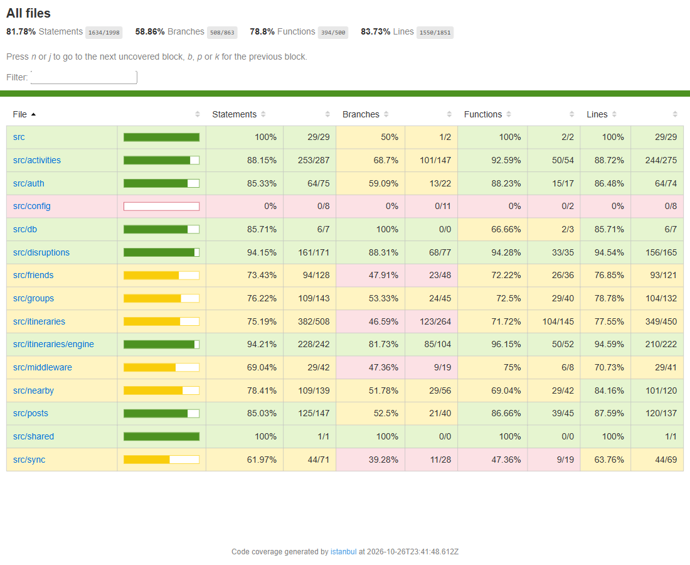
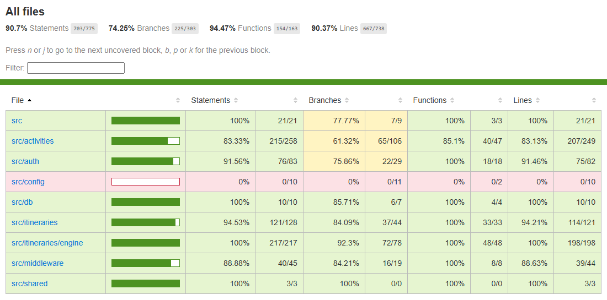
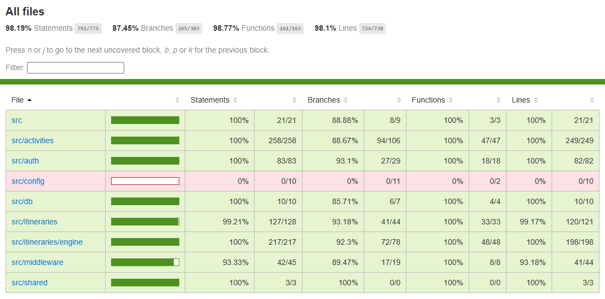

# Testing

## 1. Change History

| **Change Date** | **Modified Sections** | **Rationale** |
| --------------- | --------------------- | ------------- |
| 2026-10-17 | All | First version for CP1: back-end interface tests for every API of the Auth & Profile Service, the Activity & Review Service and the Itinerary Engine; the first non-functional requirement test; and the end-to-end test design for Generate Itinerary. |

---

## 2. Back-end Test Specification: APIs

### 2.1. Locations of Back-end Tests and Instructions to Run Them

#### 2.1.1. Tests

| **Interface** | **Describe Group Location, No Mocks** | **Describe Group Location, With Mocks** | **Mocked Components** |
| --- | --- | --- | --- |
| **POST /api/auth/google** | [`backend/tests/no-mock/auth.test.ts#L13`](../backend/tests/no-mock/auth.test.ts#L13) | [`backend/tests/mock/auth.test.ts#L29`](../backend/tests/mock/auth.test.ts#L29) | Google Identity Services (token verification), User DB |
| **GET /api/users/me** | [`backend/tests/no-mock/auth.test.ts#L60`](../backend/tests/no-mock/auth.test.ts#L60) | [`backend/tests/mock/auth.test.ts#L173`](../backend/tests/mock/auth.test.ts#L173) | User DB |
| **PUT /api/users/me** | [`backend/tests/no-mock/auth.test.ts#L153`](../backend/tests/no-mock/auth.test.ts#L153) | [`backend/tests/mock/auth.test.ts#L195`](../backend/tests/mock/auth.test.ts#L195) | User DB |
| **GET /api/activities** | [`backend/tests/no-mock/activities.test.ts#L22`](../backend/tests/no-mock/activities.test.ts#L22) | [`backend/tests/mock/activities.test.ts#L46`](../backend/tests/mock/activities.test.ts#L46), [`#L201`](../backend/tests/mock/activities.test.ts#L201) (through the production Google Places client) | Google Places API, Activity DB |
| **POST /api/activities/:activityId/reviews** | [`backend/tests/no-mock/reviews.test.ts#L27`](../backend/tests/no-mock/reviews.test.ts#L27) | [`backend/tests/mock/reviews.test.ts#L25`](../backend/tests/mock/reviews.test.ts#L25) | Review DB, Activity DB, City catalogue DB |
| **POST /api/itineraries/generate** | [`backend/tests/no-mock/itineraries.test.ts#L29`](../backend/tests/no-mock/itineraries.test.ts#L29) | [`backend/tests/mock/itineraries.test.ts#L34`](../backend/tests/mock/itineraries.test.ts#L34) | Google Places API (lodging lookup), Itinerary DB |
| **GET /api/itineraries/:itineraryId** | [`backend/tests/no-mock/itineraries.test.ts#L204`](../backend/tests/no-mock/itineraries.test.ts#L204) | [`backend/tests/mock/itineraries.test.ts#L133`](../backend/tests/mock/itineraries.test.ts#L133) | Itinerary DB |
| **GET /api/itineraries** | [`backend/tests/no-mock/itineraries.test.ts#L253`](../backend/tests/no-mock/itineraries.test.ts#L253) | [`backend/tests/mock/itineraries.test.ts#L154`](../backend/tests/mock/itineraries.test.ts#L154) | Itinerary DB |
| **GET /health** | [`backend/tests/no-mock/health.test.ts#L10`](../backend/tests/no-mock/health.test.ts#L10) | [`backend/tests/mock/health.test.ts#L11`](../backend/tests/mock/health.test.ts#L11) | MongoDB connection state |

The tests without mocks run against a real MongoDB (an in-memory server started by the tests, see `backend/tests/helpers/testDatabase.ts`) and pre-populate the Vancouver catalogue in the database, so they need no Google Places key. The Itinerary Engine's scheduling core is also unit-tested in [`backend/tests/unit/`](../backend/tests/unit/), including a comparison against a brute-forced optimum.

#### 2.1.2. Commit Hash Where Tests Run

`5a8412acc71555a59b9d7d039262224ebf3dc309`

#### 2.1.3. Explanation on How to Run the Tests

1. **Clone the repository** and install the back-end dependencies (Node.js 22 and npm 10 are required; Docker is not needed for the tests):
   ```
   git clone https://github.com/abhiverma13/TimeTravel.git
   cd TimeTravel/backend
   npm ci
   ```
2. **Run the interface tests** (with mocks, without mocks, then combined, each with coverage) from the repository root:
   ```
   ./scripts/run-backend-interface-tests.sh      # or .\scripts\run-backend-interface-tests.ps1 on Windows
   ```
3. **Run the non-functional requirement tests**:
   ```
   ./scripts/run-backend-nfr-tests.sh            # or .\scripts\run-backend-nfr-tests.ps1 on Windows
   ```
4. **Run everything at once** (interface, unit and NFR tests): `cd backend && npm test`.

The first run downloads a MongoDB binary for the in-memory server (about 1 minute); later runs reuse it. Coverage reports are written to `backend/coverage/mock`, `backend/coverage/no-mock` and `backend/coverage/interface`.

### 2.2. GitHub Actions Configuration Location

[`.github/workflows/backend-tests.yml`](../.github/workflows/backend-tests.yml): on every push to `main` (and every pull request into `main`) it type-checks the back-end and runs the mocked, unmocked and combined interface tests with coverage, the unit tests and the NFR tests, and uploads the coverage reports as an artifact.

### 2.3. Jest Coverage Report Screenshots With Mocks



```
File                     | % Stmts | % Branch | % Funcs | % Lines | Uncovered Line #s
-------------------------|---------|----------|---------|---------|-----------------------------
All files                |   90.83 |    71.61 |   93.25 |   90.78 |
  app.ts                 |     100 |    77.77 |     100 |     100 | 3-17
  activityModel.ts       |     100 |      100 |     100 |     100 |
  activityRoutes.ts      |     100 |       50 |     100 |     100 | 40
  activityService.ts     |   91.66 |       75 |     100 |   91.35 | 72,80-84,150
  communityScore.ts      |     100 |      100 |     100 |     100 |
  interests.ts           |     100 |    66.66 |     100 |     100 | 84-85
  openingHours.ts        |     100 |      100 |     100 |     100 |
  placesClient.ts        |     100 |    77.77 |     100 |     100 | 75-79
  reviewModel.ts         |   81.81 |       50 |     100 |   81.81 | 39,42,45,48
  reviewTags.ts          |    77.5 |    42.85 |   83.33 |    77.5 | 24-25,42-43,52,56-57,61,66
  authRoutes.ts          |     100 |       50 |     100 |     100 | 15
  authService.ts         |   76.31 |    57.14 |     100 |   76.31 | 43,46,52-55,64,67-70
  googleTokenVerifier.ts |     100 |      100 |     100 |     100 |
  userModel.ts           |      80 |      100 |   33.33 |   88.88 | 21
  env.ts                 |       0 |        0 |       0 |       0 | 2-16
  connection.ts          |      90 |    85.71 |      75 |      90 | 17
  itineraryModel.ts      |     100 |      100 |     100 |     100 |
  itineraryRoutes.ts     |   89.65 |       50 |     100 |   89.65 | 30,33,36
  itineraryService.ts    |   86.56 |    72.72 |      90 |   86.66 | 110,128,153,159-162,169-175
  tripCalendar.ts        |   95.45 |       60 |    87.5 |   95.45 | 21
  candidates.ts          |   96.42 |    83.33 |     100 |      96 | 22
  daySchedule.ts         |     100 |    91.66 |     100 |     100 | 37
  localSearch.ts         |     100 |    95.23 |     100 |     100 | 14
  planner.ts             |    97.4 |    82.75 |     100 |   97.14 | 16,20
  travelTime.ts          |     100 |      100 |     100 |     100 |
  types.ts               |     100 |      100 |     100 |     100 |
  authenticate.ts        |   77.77 |       50 |     100 |   77.77 | 12-13,20,28
  errorHandler.ts        |   66.66 |    46.15 |      60 |   69.23 | 21,26-27,34-36,39-40
  interestTags.ts        |     100 |      100 |     100 |     100 |
```

### 2.4. Jest Coverage Report Screenshots Without Mocks



```
File                     | % Stmts | % Branch | % Funcs | % Lines | Uncovered Line #s
-------------------------|---------|----------|---------|---------|-------------------
All files                |    90.7 |    74.25 |   94.47 |   90.37 |
  app.ts                 |     100 |    77.77 |     100 |     100 | 3-17
  activityModel.ts       |     100 |      100 |     100 |     100 |
  activityRoutes.ts      |     100 |      100 |     100 |     100 |
  activityService.ts     |   80.95 |     62.5 |   83.33 |   81.48 | 94,148,153-173
  communityScore.ts      |   94.11 |       50 |     100 |   93.33 | 26
  interests.ts           |     100 |       50 |     100 |     100 | 76-85
  openingHours.ts        |   93.75 |    91.66 |     100 |   93.33 | 14
  placesClient.ts        |       0 |        0 |       0 |       0 | 2-86
  reviewModel.ts         |     100 |      100 |     100 |     100 |
  reviewTags.ts          |     100 |    92.85 |     100 |     100 | 22
  authRoutes.ts          |     100 |      100 |     100 |     100 |
  authService.ts         |   94.73 |    90.47 |     100 |   94.73 | 29-30
  googleTokenVerifier.ts |   58.33 |    16.66 |     100 |   58.33 | 9,12-16
  userModel.ts           |     100 |      100 |     100 |     100 |
  env.ts                 |       0 |        0 |       0 |       0 | 2-16
  connection.ts          |     100 |    85.71 |     100 |     100 | 3
  itineraryModel.ts      |     100 |      100 |     100 |     100 |
  itineraryRoutes.ts     |     100 |      100 |     100 |     100 |
  itineraryService.ts    |   89.55 |    81.81 |     100 |   88.33 | 90,110,186-193
  tripCalendar.ts        |     100 |       80 |     100 |     100 | 25
  candidates.ts          |     100 |    91.66 |     100 |     100 | 17
  daySchedule.ts         |     100 |    91.66 |     100 |     100 | 37
  localSearch.ts         |     100 |    95.23 |     100 |     100 | 14
  planner.ts             |     100 |    89.65 |     100 |     100 | 32,53,96
  travelTime.ts          |     100 |      100 |     100 |     100 |
  types.ts               |     100 |      100 |     100 |     100 |
  authenticate.ts        |   94.44 |    83.33 |     100 |   94.44 | 28
  errorHandler.ts        |   85.18 |    84.61 |     100 |   84.61 | 26-27,42-43
  interestTags.ts        |     100 |      100 |     100 |     100 |
```

Without mocks, the Google Places client and the success path of Google token verification are not reached: real calls need a Places API key and a real Google ID token, which the tests cannot obtain. Those paths, and database failures, are covered by the tests with mocks.

### 2.5. Jest Coverage Report Screenshots With and Without Mocks Combined



```
File                     | % Stmts | % Branch | % Funcs | % Lines | Uncovered Line #s
-------------------------|---------|----------|---------|---------|-------------------
All files                |   98.19 |    87.45 |   98.77 |    98.1 |
  app.ts                 |     100 |    88.88 |     100 |     100 | 3
  activityModel.ts       |     100 |      100 |     100 |     100 |
  activityRoutes.ts      |     100 |      100 |     100 |     100 |
  activityService.ts     |     100 |     87.5 |     100 |     100 | 16-19,41,169
  communityScore.ts      |     100 |      100 |     100 |     100 |
  interests.ts           |     100 |    66.66 |     100 |     100 | 84-85
  openingHours.ts        |     100 |      100 |     100 |     100 |
  placesClient.ts        |     100 |    77.77 |     100 |     100 | 75-79
  reviewModel.ts         |     100 |      100 |     100 |     100 |
  reviewTags.ts          |     100 |    92.85 |     100 |     100 | 22
  authRoutes.ts          |     100 |      100 |     100 |     100 |
  authService.ts         |     100 |    90.47 |     100 |     100 | 3-40
  googleTokenVerifier.ts |     100 |      100 |     100 |     100 |
  userModel.ts           |     100 |      100 |     100 |     100 |
  env.ts                 |       0 |        0 |       0 |       0 | 2-16
  connection.ts          |     100 |    85.71 |     100 |     100 | 3
  itineraryModel.ts      |     100 |      100 |     100 |     100 |
  itineraryRoutes.ts     |     100 |      100 |     100 |     100 |
  itineraryService.ts    |    98.5 |    93.93 |     100 |   98.33 | 110
  tripCalendar.ts        |     100 |       80 |     100 |     100 | 25
  candidates.ts          |     100 |    91.66 |     100 |     100 | 17
  daySchedule.ts         |     100 |    91.66 |     100 |     100 | 37
  localSearch.ts         |     100 |    95.23 |     100 |     100 | 14
  planner.ts             |     100 |    89.65 |     100 |     100 | 32,53,96
  travelTime.ts          |     100 |      100 |     100 |     100 |
  types.ts               |     100 |      100 |     100 |     100 |
  authenticate.ts        |   94.44 |    83.33 |     100 |   94.44 | 28
  errorHandler.ts        |   92.59 |     92.3 |     100 |    92.3 | 26-27
  interestTags.ts        |     100 |      100 |     100 |     100 |
```

**Why the combined coverage is below 100%:**

- **`src/config/env.ts` (0%)**: it reads the environment variables once when the server process starts and is only imported by `src/index.ts`, the start-up file excluded from coverage. The interface tests build the app with explicit test configuration (see `backend/tests/helpers/testApp.ts`) so they do not depend on a developer's `.env`; `env.ts` runs every time the server starts with `scripts/run-backend.*`.
- **`src/itineraries/itineraryService.ts` line 110**: a guard for a planned stop whose activity is not among the candidates. The engine only schedules the candidates it is given, so this cannot happen; the guard exists because TypeScript's `Map.get` may return `undefined`.
- **`src/middleware/errorHandler.ts` lines 26-27**: hands an error to Express's default handler if a response was already partly sent. No route writes a response before failing, so this cannot be reached through the API; it is the error-handling pattern from the Express documentation.
- **`src/middleware/authenticate.ts` line 28**: rejects a request if a protected route is reached without the session middleware. Every protected router installs `requireSession`, so this is a defensive check.
- **Remaining branch gaps** (for example `interests.ts` 84-85, `placesClient.ts` 75-79, `tripCalendar.ts` 25, the engine files): default values in destructuring and `??` fallbacks for fields Google Places may omit, which TypeScript's strict null checks require even where the data always has them.

---

## 3. Tests of Non-Functional Requirements

### 3.1. Test Locations in Git

| **Non-Functional Requirement** | **Location in Git** |
| --- | --- |
| **NFR 1: Itinerary generation time** | [`backend/tests/nfr/itineraryGenerationTime.test.ts`](../backend/tests/nfr/itineraryGenerationTime.test.ts) |
| **NFR 3: Bounded Google Places usage** | Covered for CP1 by the mocked interface tests "Cache miss searches Places once per interest, then caches" and "City with no activities" in [`backend/tests/mock/activities.test.ts`](../backend/tests/mock/activities.test.ts#L46); a dedicated NFR test is planned for CP2. |
| **NFR 2: Live update latency** | Planned for CP2 with the Trip Sync & Disruption Service. |

### 3.2. Test Verification and Logs

- **NFR 1: Itinerary generation time**

  - **Verification:** The test loads the 30-activity Vancouver catalogue plus 30 synthetic downtown activities, so pruning still leaves the maximum of 40 candidates, then sends 20 consecutive `POST /api/itineraries/generate` requests for a 5-day trip (08:00 to 21:00 days, packed pace, all interests) through the real Express app and an in-memory MongoDB. It measures each request from send to response, which includes reading the catalogue, the engine's solve and saving the itinerary, and asserts that the 95th percentile is under 3,000 ms. It also checks that every response is 201 with 5 days and that the engine really saw 40 candidates.
  - **Log Output**
    ```
    ==> Running backend NFR tests (tests/nfr/) ...
      console.info
        NFR itinerary generation: 20 runs, 5 days, 40 candidates, 33 stops
        p50 345 ms, p95 416 ms, max 457 ms (limit 3000 ms)

    Test Suites: 1 passed, 1 total
    Tests:       1 passed, 1 total
    ==> Backend NFR tests finished.
    ```

---

## 4. Front-end Test Specification

### 4.1. Location in Git of Front-end Test Suite:

[`frontend/app/src/androidTest/java/com/example/cpen321application/e2e/`](../frontend/app/src/androidTest/java/com/example/cpen321application/e2e/)

The CP1 app tags the elements these tests use with stable test tags ([`ui/common/TestTags.kt`](../frontend/app/src/main/java/com/example/cpen321application/ui/common/TestTags.kt)), so the tests do not depend on wording. As the course requires, each test starts on the home screen with a signed-in user and no pre-existing trips.

### 4.2. Tests

- **Use Case: Generate Itinerary** ([formal specification](Requirements_and_Design.md#uc3)) (test design for CP1; implementation in CP2)

  - **Expected Behaviors:**

    | **Scenario Steps** | **Test Case Steps** |
    | ------------------ | ------------------- |
    | 1. The organizer taps "Plan a trip" on the home screen. | Click the node tagged `homePlanTrip`. |
    | 2. The app shows the Trip Builder, with the destination prefilled from the home city and the interests from the profile. | Check the node tagged `tripCityField` is displayed. Check the button tagged `generateButton` with text "Generate itinerary" is displayed. |
    | 3a. The destination is empty. | Clear `tripCityField`. Click `generateButton`. |
    | 3a1. The app shows "Enter a destination city." and does not generate. | Check `tripError` has text "Enter a destination city.". Check the Trip Builder is still displayed. |
    | 3b. No dates are chosen. | Type "Vancouver" in `tripCityField`. Click `generateButton`. |
    | 3b1. The app shows "Choose your trip dates." and does not generate. | Check `tripError` has text "Choose your trip dates.". |
    | 3c. The trip is longer than 7 days. | Click `tripDatesButton`. In the date picker, choose a start date and an end date 8 days later (dates are computed from today). Click "Done". Click `generateButton`. |
    | 3c1. The app shows "Trips can be at most 7 days." and does not generate. | Check `tripError` has text "Trips can be at most 7 days.". |
    | 3. The organizer enters the destination city and chooses the trip dates. | Click `tripDatesButton`. Choose a start date 7 days from today and an end date 9 days from today. Click "Done". Check `tripDatesButton` shows "3 days". |
    | 4a. The day ends less than 2 hours after it starts. | Open the "Start" dropdown and choose 17:00. Click `generateButton`. |
    | 4a1. The app shows "Your day must end at least 2 hours after it starts." and does not generate. | Check `tripError` has text "Your day must end at least 2 hours after it starts.". Open the "Start" dropdown and choose 09:00. |
    | 4. The organizer optionally changes the day times, arrival and departure, lodging, interests and pace. | Open the "Arrive" dropdown and choose 13:00. Click the "Museums" chip. Click the "Relaxed" segment. |
    | 5. The organizer taps "Generate itinerary". | Click `generateButton`. |
    | 6. The system ranks and schedules the city's activities into each day. | Wait until a node tagged `itineraryDay` is displayed (up to 10 s). |
    | 7. The app shows the itinerary as a day-by-day timeline. | Check three nodes tagged `itineraryDay` exist. Check at least one node tagged `itineraryStop` exists. Check the first day's first stop starts at or after 13:00. Check the text "Back at lodging by" is displayed. |
    | 6b. The lodging cannot be found. | Go back to home, click `homePlanTrip`, choose the same dates, type "zzzz no such hotel" in `tripLodgingField`, click `generateButton`. |
    | 6b1-6b2. The system plans from the city centre and the itinerary shows a warning. | Check a node tagged `itineraryWarning` contains "Could not find". Check the text "From Vancouver centre" is displayed. |

    Failure scenario 6a (no activities for the city) needs a city the back-end cannot find activities for, and 6d (TimeTravel unreachable) needs the back-end to be stopped; both are verified manually, because the front-end tests run against the real deployed back-end without mocks.

  - **Test Logs:**
    ```
    To be added in CP2, when this test is implemented.
    ```
